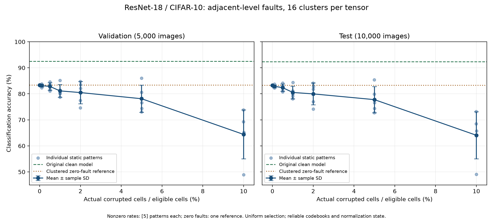
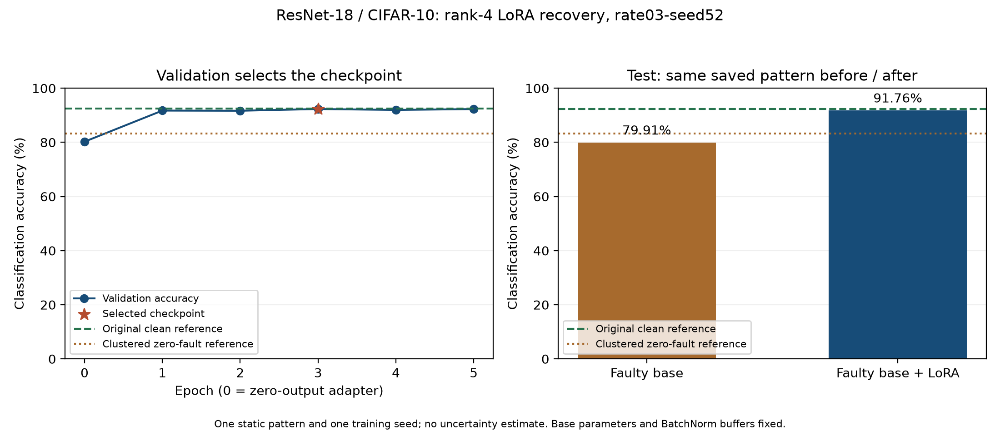
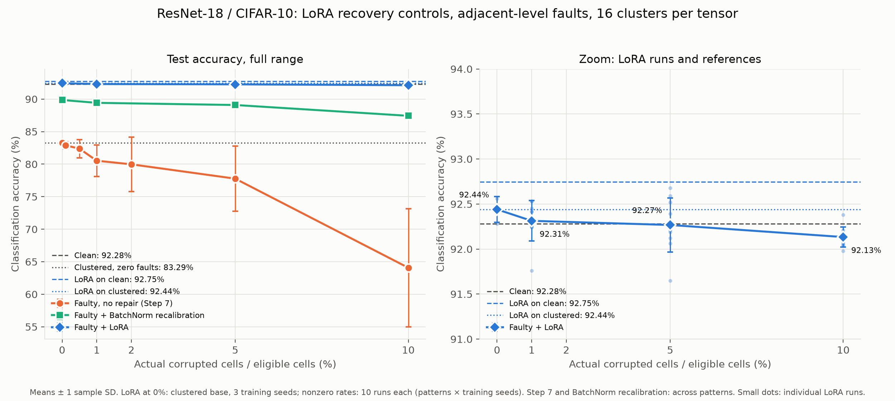

# Fault-Tolerant Neural Networks with Low-Rank Adaptation

This research project asks whether small trainable LoRA adapters can recover
performance lost when hardware memory faults corrupt a neural network's stored
weights. Dense memory can reduce parameter-storage area, but increasing the
number of distinguishable physical levels per cell can make reads less reliable.
The intended experiments will examine the tradeoff between storage efficiency,
model performance, and adapter overhead.

## Implementation status

Steps 1–8 are complete. Clean and k=16 clustered ResNet-18 baselines have been
evaluated on CIFAR-10, and their configurations, splits, preprocessing,
checkpoints/encodings, provenance, and measured results are saved locally. The
original clean checkpoint is preserved. A simplified adjacent-level simulator
has saved one static 1%-probability fault pattern and its reconstructed faulty
checkpoint. All eight full-model Step 6 audit checks and 60 unit tests pass.
Step 7 completed 31 static-pattern evaluations across seven probabilities, with
five patterns per nonzero rate, and saved individual measurements and plots.
Step 8 trained rank-4 LoRA adapters for five epochs on one saved 1% pattern,
with all base parameters and normalization buffers frozen. Its paired test
accuracy changed from 79.91% to 91.76%.
Step 9a generalized that recovery code to clean, clustered, and faulty bases,
added a batch runner and an evaluation-only adapter-transfer utility, and ran
no new training. Step 9b trained the same LoRA recipe on clean and clustered
bases and on all 15 saved 1%, 5%, and 10% patterns (36 runs), and added a
no-training BatchNorm-recalibration baseline. LoRA reached 92.13–92.44% mean test
accuracy on every clustered or faulty base, within 0.31 pp of LoRA on the
zero-fault clustered base. Transfer to unseen patterns, rank/placement studies,
and the language-model extension remain future work.

## Completed workflow

1. [Repository scaffold and Python environment](#step-1-repository-scaffold-and-python-environment)
2. [Dependencies and compute setup](#step-2-dependencies-and-compute-setup)
3. [Clean ResNet-18 baseline](#step-3-clean-resnet-18-baseline)
4. [Clustered-weight baseline](#step-4-clustered-weight-baseline)
5. [Fault simulation](#step-5-fault-simulation)
6. [Fault-injection correctness checks](#step-6-fault-injection-correctness-checks)
7. [Fault-rate experiments](#step-7-fault-rate-experiments)
8. [LoRA recovery](#step-8-lora-recovery)
9. [Generalized recovery runner (9a)](#step-9a-generalized-recovery-runner)
10. [LoRA control matrix and BatchNorm recalibration (9b)](#step-9b-lora-control-matrix-and-batchnorm-recalibration)

## Step 1: Repository scaffold and Python environment

**Purpose:** establish an organized repository and a usable local Python environment.

We created the package layout, empty package initializers, configuration/script/test
folders, `.gitignore`, and the initial README. Git was initialized for the project.
A usable project-local `.venv` was inspected and reused; its executable reports
**Python 3.11.4**. System Python was not changed. Model code and experiments were
added only in the later steps documented below.

### Project structure

| Path | Purpose |
| --- | --- |
| `src/fault_lora/` | Root Python package for the research workflow. |
| `src/fault_lora/models/` | ResNet-18 loading and checkpoint restoration; convolutional and linear LoRA adapters. |
| `src/fault_lora/data/` | Dataset preparation, preprocessing, and split handling. |
| `src/fault_lora/memory/` | Scalar clustering, codebooks, typed indices, reversible physical mappings, and static adjacent-level patterns; future shared component integration. |
| `src/fault_lora/evaluation/` | Classification metrics, artifact audits, fault-rate plots, BatchNorm recalibration, and the LoRA control analysis. |
| `src/fault_lora/training/` | Clean CIFAR-10 fine-tuning, adapter-only recovery training on any base, the recovery matrix runner, and adapter-transfer evaluation. |
| `configs/` | Baseline, fault-generation, audit, sweep, and LoRA recovery configurations. |
| `scripts/` | Environment checks, baselines, fault generation/audits, sweeps, LoRA recovery, the recovery matrix, BatchNorm recalibration, and the control analysis. |
| `tests/` | Offline baseline, representation, and integrity checks. |
| `docs/figures/` | Repository copies of verified Step 7, 8, and 9b PNG/PDF figures embedded in this README. |
| `results/` | Generated measurements and plots; ignored by Git. |
| `checkpoints/` | Pretrained weights, clean/decoded checkpoints, clustered encodings, sparse patterns, and adapter-only checkpoints; ignored by Git. |
| `data/` | Downloaded CIFAR-10 files; ignored by Git. |
| `.venv/` | Local Python virtual environment; ignored by Git. |
| `requirements.txt` | Exact versions of the five direct dependencies. |
| `requirements-macos-arm64.lock.txt` | Platform-specific versions and wheel hashes for all resolved dependencies. |

The root-anchored `/data/` ignore rule excludes downloaded datasets while
preserving the source package `src/fault_lora/data/`. Generated-output directories
are ignored; the selected README figures are copied into `docs/figures/`.

### Virtual environment

From the project root, activate the environment in the detected zsh shell:

```sh
source .venv/bin/activate
```

The same activation command works in bash. Verify or invoke the environment
explicitly, without relying on activation persisting across separate shells:

```sh
.venv/bin/python --version
```

For a fresh checkout without a `.venv`, use an existing Python 3.11 interpreter
to reproduce this dependency environment. Inspect any existing environment
before creating one:

```sh
python3.11 --version
python3.11 -m venv .venv
source .venv/bin/activate
.venv/bin/python --version
```

**Verification:** required directories and initializers existed, the environment's
Python executable worked, and generated datasets/checkpoints/results and `.venv/`
were ignored while `src/fault_lora/data/` remained available to track.

## Step 2: Dependencies and compute setup

**Purpose:** install compatible dependencies and verify the available compute devices.

We installed the core libraries into the existing `.venv`, pinned the direct
versions, and generated the macOS arm64 / CPython 3.11 lockfile with wheel hashes.
CPU and MPS tensor execution were verified before model experiments began.

| Package | Installed version | Implemented role |
| --- | --- | --- |
| PyTorch (`torch`) | 2.14.1 | Tensor operations, ResNet training, and inference. |
| `torchvision` | 0.29.1 | ResNet models, CIFAR-10 datasets, and preprocessing. |
| NumPy | 2.4.6 | Array handling and experiment data. |
| scikit-learn | 1.9.1 | Per-tensor weight clustering. |
| Matplotlib | 3.11.2 | Validation/test fault-rate plots. |

These versions were selected by resolving compatible binary wheels for the
actual environment and verifying them together. Transformers and PEFT are
deferred until the language-model or adapter steps need them.

On a matching macOS arm64 / CPython 3.11 environment, install the full lockfile:

```sh
.venv/bin/python -m pip install --index-url https://pypi.org/simple --only-binary=:all: --require-hashes -r requirements-macos-arm64.lock.txt
.venv/bin/python -m pip check
.venv/bin/python scripts/check_environment.py
```

The lockfile pins all 28 resolved packages, including transitive dependencies
and the setuptools version required by PyTorch, with their exact wheel hashes.
Pip itself is not pinned. The native macOS wheels require macOS 14 or later.
This lockfile is specific to CPython 3.11 on macOS arm64; another platform or
Python minor version needs its own resolution and verification. The shorter
`requirements.txt` records direct versions, but does not lock transitive versions
or wheel hashes. A Linux/CUDA environment has not been configured or tested.

The check prints a JSON report of the Python/platform versions, package
versions, backend availability, selected device, and verification results.
It imports all five libraries, checks the headless Matplotlib Agg backend,
tests the NumPy/PyTorch bridge, performs tiny float32 matrix multiplications on
CPU and the selected device, and exercises a compiled torchvision operator on
CPU. It does not instantiate models, download anything, train, evaluate datasets,
or write plots. Import and tensor failures cause a nonzero exit status.

For an explicit device check:

```sh
.venv/bin/python scripts/check_environment.py --device cpu
.venv/bin/python scripts/check_environment.py --device mps
```

Automatic selection chooses an available CUDA device, then MPS, then CPU. An
explicit unavailable device fails rather than silently switching devices.

### Local compute

The inspected machine is an Apple M3 Pro MacBook Pro running macOS 26.6, with
11 CPU cores, a 14-core Apple GPU, and 18 GB of unified memory. Python runs
natively as arm64. The installed PyTorch build includes MPS and has no available
CUDA backend on this machine.

Library imports, CPU tensor checks, and the compiled torchvision operator check
passed. MPS was unavailable inside the Codex sandbox, but an explicit MPS check
outside the sandbox passed, including GPU matrix multiplication and transfer
back to CPU. Both CPU and MPS execution are verified; run future GPU workflows
in a process that has GPU access.

PyTorch's [MPS backend](https://docs.pytorch.org/docs/2.14/notes/mps.html) provides
GPU tensor execution through Apple's Metal framework. Backend availability must
be checked in the process that will run the experiment; restricted execution
environments may hide GPU access. These installation checks do not establish
model throughput, training capacity, or compatibility of every model operator.

## Step 3: Clean ResNet-18 baseline

**Purpose:** fine-tune an ImageNet-pretrained ResNet-18 for CIFAR-10 and save a reproducible clean reference.

The selected workflow is CIFAR-10 with torchvision's
[ImageNet-pretrained ResNet-18](https://docs.pytorch.org/vision/stable/models/generated/torchvision.models.resnet18.html)
(`IMAGENET1K_V1`). Its final classifier is replaced with a ten-class linear
layer, and all model parameters are fine-tuned. The original convolutional stem
and max-pooling are preserved. This is a target-dataset baseline, not a direct
evaluation of an ImageNet classifier on CIFAR-10.

The initial configuration uses seed 42 and five epochs of SGD with momentum
0.9 and weight decay 0.0005. Backbone and classifier learning rates start at
0.001 and 0.01, respectively, with cosine decay. Training batch size is 128 and
evaluation batch size is 256. This bounded initial recipe is not claimed to be
an optimized CIFAR-10 result.

The completed run selected epoch 5 using validation performance and measured:

| Split | Examples | Correct | Accuracy | Mean cross-entropy |
| --- | ---: | ---: | ---: | ---: |
| Validation | 5,000 | 4,622 | 92.44% | 0.2180 |
| Official test | 10,000 | 9,228 | 92.28% | 0.2299 |

These are actual local measurements from the saved checkpoint, not published
ResNet reference numbers. The initial download/training/evaluation run took
421.4 seconds on MPS. Results describe one seeded run with the documented
96×96 preprocessing; they do not establish variability across training seeds.

The official 50,000-image training set is split into 45,000 training images and
5,000 validation images, reserving 500 per class. The explicit indices are saved.
The official 10,000-image test set is separate and is evaluated once, after all
epochs and validation-only selection of the checkpoint. Selection uses highest
validation accuracy, then lowest validation cross-entropy loss; exact ties
retain the earlier epoch. No test measurements affect checkpoint selection.

Training uses random 32-pixel crops with four pixels of padding and horizontal
flips. Images are then resized directly to 96×96 and normalized with ImageNet
mean/std. Evaluation uses the same resize and normalization with no random
augmentation. **This resolution and direct resizing differ from the pretrained
weights' default 256-resize/224-center-crop preprocessing.** They are saved as an
explicit choice for the local baseline and must remain fixed in later controlled
comparisons. Accuracy is reported as a fraction; cross-entropy is averaged over
examples, including incomplete final batches.

Run from the project root in a process with MPS and network access:

```sh
.venv/bin/python scripts/run_clean_baseline.py --config configs/resnet18_cifar10.json --download
```

`--download` permits downloading CIFAR-10 when missing. The pretrained ResNet-18
weights are cached under `checkpoints/torch-cache/`. Existing dataset files are
integrity-checked by torchvision. Change the configuration's `device` to `cpu`
to run without GPU access; an unavailable explicitly selected device fails.
Change `run_id` for a new run. The command refuses to overwrite existing run
directories. A failed or interrupted run has a status record and may retain
completed-epoch checkpoints; it is not presented as a completed baseline.
`last.pt` stores model weights, not an optimizer-resume state; reproduction
starts a fresh run with the saved configuration.

Artifacts for this run are saved under:

- `checkpoints/resnet18-cifar10-clean-seed42/best.pt`: validation-selected clean
  model, architecture, class order, preprocessing, provenance, and metadata.
- `checkpoints/resnet18-cifar10-clean-seed42/last.pt`: final completed epoch's
  weights and metadata.
- `results/resnet18-cifar10-clean-seed42/`: configuration, split indices,
  preprocessing, environment, manifest, epoch history, status, and final metrics.

The manifest records dataset integrity information, pretrained-weight and split
hashes, and checkpoint selection policy. Final metrics include the selected
checkpoint's SHA-256 hash. Checkpoints can be restored with
`fault_lora.models.resnet.load_clean_checkpoint` without another model download.
Random generators and data-loader workers are seeded; identical bits across
different devices or library versions are not guaranteed. Generated data,
checkpoints, and results remain ignored by Git.

The completed initial run also has `source_sha256.json`, recording hashes of the
source, configuration, and dependency files used for that run. The selected
checkpoint hash is
`7a9d200cbce14c01ddadb68c3a94ce8a9a7990a4cfcdfb7d9f5ae4bdfac47439`.
Seven offline correctness checks passed.

Offline checks require no model or dataset downloads:

```sh
.venv/bin/python -m unittest discover -s tests -v
```

## Step 4: Clustered-weight baseline

**Purpose:** store weights using codebooks and indices, then measure clustering loss with zero faults.

The implemented representation groups similar scalar weights into clusters within
each eligible layer. Representative values form a lookup table, or codebook;
each weight position stores an index into that table. For example, a weight of
0.113 might be represented by 0.10 at codebook index 2. A memory read decodes the
stored index and retrieves its representative weight.

Two sources of performance loss must be measured separately:

- **Clustering (compression) loss:** replacing the original weights with
  representatives can change predictions even when every read is correct.
  Compare the original model with the clustered, fault-free model.
- **Fault loss:** incorrect reads cause additional substitutions. Compare the
  clustered, fault-free model with the same representation under faults.

The first configuration uses **16 clusters per eligible weight tensor** with
seed 42. Eligible tensors are all 21 ResNet-18 Conv2d/Linear weights, including
the stem, residual projection convolutions, and classifier: 11,172,032 scalar
weights in total. Biases, batch-normalization parameters, running statistics,
and counters are retained exactly from the clean model. The source is the saved
Step 3 validation-selected checkpoint; no additional training occurs.

The completed paired evaluation measured:

| Split | Clean accuracy | Clustered, zero-fault accuracy | Accuracy drop |
| --- | ---: | ---: | ---: |
| Validation (5,000 images) | 92.44% | 83.34% | 9.10 percentage points |
| Official test (10,000 images) | 92.28% | 83.29% | 8.99 percentage points |

The clustered test model made 8,329 correct predictions, with mean cross-entropy
0.5055 versus the clean model's 0.2299. The clean replay reproduced Step 3's
counts and losses exactly. This is measured clustering/compression loss with
zero faults, not fault loss. Sixteen representatives across all selected tensors
caused a substantial accuracy reduction in this experiment. This single-seed
result does not establish that other counts or layer selections behave the same
way. The clustering and paired evaluation run took 87.4 seconds.

`memory/clustering.py` fits scalar
[scikit-learn KMeans](https://scikit-learn.org/stable/modules/generated/sklearn.cluster.KMeans.html)
independently per tensor using every weight, Lloyd's algorithm, k-means++
initialization, three initializations, a 100-iteration limit, and tolerance
0.0001. Tensor ordinal is added to the run seed to obtain a recorded per-tensor
seed. Four CPU threads are used. Local k-means solutions are not claimed to be
globally optimal. Each codebook is sorted and its assignment labels are remapped
to preserve the decoded weights. A tensor with fewer distinct values than the
requested cluster count uses those exact distinct values and records its actual
codebook size.

The initial physical representation assumes one memory cell per index, with
identity index-to-level mapping into levels 0–15 for each 16-entry codebook.
Both mapping directions are saved, and decoding supports a different saved
permutation. A level change would select a different representative; the
representative's numerical difference need not be one. This is an initial
experimental assumption, not a hardware-calibrated encoding or an exact
reproduction of the reference paper. Codebooks and mapping metadata are assumed
reliable. Step 4 performs **no fault injection**.

Run with existing local CIFAR-10 data and access to MPS:

```sh
.venv/bin/python scripts/run_clustered_baseline.py --config configs/resnet18_cifar10_clustered.json
```

The runner verifies the clean checkpoint hash and saved split hash before
clustering. It saves an encoding containing codebooks, uint8 indices, physical
mappings, and all untouched state, then reloads that artifact and reconstructs
the model. Index decoding and physical-level decoding must agree. The source
model state and source checkpoint file are checked for preservation.

Clean and reconstructed clustered models are evaluated on the same saved
validation and official test splits with the exact Step 3 preprocessing and
evaluation batch size. The clean model is measured again in the same run so
that the reported accuracy difference uses matched conditions. The original
Step 3 clean measurements are also recorded, along with any difference in
correct prediction count. Cluster count is fixed in advance; the run does not
select a configuration using these evaluation results.

Artifacts are stored under
`checkpoints/resnet18-cifar10-clustered-k16-seed42/` and
`results/resnet18-cifar10-clustered-k16-seed42/`:

| Artifact | Purpose |
| --- | --- |
| `encoding.pt` | Self-contained codebooks, indices, physical mappings, untouched state, and metadata. |
| `clustered_dense.pt` | Dense reconstructed weights for ordinary ResNet inference; stored separately from the encoding. |
| `layers.json` | Per-tensor codebooks, mappings, occupancy, seeds, solver iterations, and weight errors. |
| `metrics.json` | Paired clean/clustered measurements, signed accuracy drop in percentage points, and cross-entropy increase. |
| `storage.json` | Actual tensor sizes, serialized file sizes, and separately labeled bit-packing estimates. |
| `manifest.json` | Tensor scope, assumptions, source provenance, algorithm, and evaluation settings. |
| Other JSON records | Configuration, source hashes, copied splits/preprocessing, environment, and completion status. |

Indices are actually stored as uint8 values, which use eight bits each. Sixteen
indices would need four bits each in an ideal packed layout, but bit packing is
not implemented. Storage estimates include codebooks, both mapping tensors,
and all untouched model state. Serialized file sizes also include archive and
metadata overhead. Ordinary inference uses reconstructed dense weights; the
encoded artifact does not establish smaller runtime memory, faster inference,
or hardware area/energy savings.

The measured original dense state contains 44,765,128 tensor bytes. The saved
representation contains 11,255,752 tensor bytes including codebooks, mappings,
and untouched state, a 3.98× tensor-size ratio. The actual serialized encoding
file is 11,312,844 bytes. The estimated packed representation would contain
5,669,736 bytes, but that layout has not been implemented.

Seventeen offline checks passed, including the original seven baseline checks.
New checks cover label remapping, deterministic encoding, exact handling of
constant/small tensors, reversible mappings, invalid representations, model
preservation, serialization, storage accounting, and source-integrity rejection.

## Step 5: Fault simulation

**Purpose:** simulate adjacent physical-level read errors and save a fixed fault pattern with exact counts.

The starting reference is [On-Chip Deep Neural Network Storage with Multi-Level
eNVM](https://www.eecs.tufts.edu/~mdonato/assets/papers/dac2018-envm.pdf)
(Donato et al., DAC 2018). Its fault model concerns reads into neighboring
physical levels, with probabilities depending on the cell configuration and
stored level.

An adjacent-level error changes a cell's physical level by one; it is distinct
from an arbitrary binary bit flip. The level-to-information mapping determines
which weight is retrieved. If an index spans multiple cells, a one-level change
in one cell need not change the complete index by one, and it never means adding
or subtracting one from the numerical weight.

A uniform-probability adjacent-level simulator is implemented as an explicit
simplification, not an exact reproduction of the reference paper. A saved,
static fault pattern means keeping the same corruption throughout an experiment;
it does not specify whether the mechanism uses neighboring levels or bit flips.

The initial configuration uses a **0.01 selection probability per eligible
cell**, seed 42, and the saved k=16 encoding from Step 4. The denominator is
11,172,032 scalar index cells across all 21 Conv2d/Linear weight tensors.
Codebooks, mappings, biases, and batch-normalization state remain reliable.
This is a uniform software model with one cell per index; its probabilities
are simplifying assumptions, not measurements or calibration from the paper.

Each cell is selected by a separate Bernoulli draw. The requested probability
does not force an exact count. For a selected interior level, up and down each
have probability 0.5. At the lowest level, the only transition is 0 → 1; at
the highest level, it is 15 → 14. Boundary events therefore always change the
physical state, with no wraparound or clipped no-op. More generally, a tensor
with K=1 has no neighboring state and is excluded from the denominator.

For the current K=16 representation:

| Stored level | Probability of correct read | Probability of reading one level lower | Probability of reading one level higher |
| --- | ---: | ---: | ---: |
| 0 | 0.99 | 0 | 0.01 |
| 1–14 | 0.99 | 0.005 | 0.005 |
| 15 | 0.99 | 0.01 | 0 |

The generated artifact contains these actual counts:

| Quantity | Recorded value |
| --- | ---: |
| Eligible cells | 11,172,032 |
| Expected selected count (N × p) | 111,720.32 |
| Actual corrupted cells | 111,858 |
| Realized fault rate | 1.001232% |
| Upward transitions | 56,326 |
| Downward transitions | 55,532 |
| Transitions from the lowest boundary | 292 |
| Transitions from the highest boundary | 89 |
| Changed decoded scalar weights | 111,858 |

Physical-cell changes and decoded-weight changes are recorded separately. They
match in this run because the selected transitions have distinct representatives;
they need not match if representatives tie. The ±1 transition refers to the
physical level, and the saved level-to-index mapping selects the resulting
codebook value. Its numerical weight difference need not be one. Overall
up/down counts need not be equal, especially with forced boundary directions.

`src/fault_lora/memory/faults.py` exposes `generate_fault_pattern`,
`summarize_fault_pattern`, and `apply_fault_pattern`. These functions take a
saved encoding and do not depend on datasets or training. Optional tensor
selection permits later sensitivity studies. Sampling uses an isolated CPU
`torch.Generator`, sorted tensor names, float64 uniform draws for selection,
and integer direction draws for the selected cells. The seed, algorithm,
tensor order, and PyTorch version are saved. A seed alone does not promise
identical sampling across library versions; the saved transitions are the
authoritative pattern for replay.

The pattern records flattened cell positions and their exact original and
destination levels. A semantic SHA-256 fingerprint binds it to the source
codebooks, indices, both mappings, and untouched state. Application validates
that fingerprint and the sparse transitions, then reconstructs an independent
dense state from the uncorrupted encoding. Replaying the same pattern does
not accumulate faults or modify its inputs. Static faults mean these saved
substitutions stay fixed throughout a later experiment; they are not resampled
on each inference call. The simulator does not currently model level-dependent
hardware error rates, multiple cells per index, or faults in reliable metadata.

Generate from existing local artifacts, using CPU only:

```sh
.venv/bin/python scripts/generate_fault_pattern.py --config configs/resnet18_cifar10_faults.json
```

The command refuses to overwrite existing run directories. Change `run_id`
for another generation, along with the desired probability and seed. It
verifies the recorded Step 4 encoding/dense hashes, exact decoding agreement,
and original clean-checkpoint hash before generating a pattern. It reloads
the saved pattern, creates a faulty checkpoint, restores that checkpoint,
checks exact tensor agreement and a finite `(2, 10)` CPU forward pass on
synthetic inputs, and confirms source artifact hashes are unchanged.

Artifacts are saved under
`checkpoints/resnet18-cifar10-faults-p001-seed42/` and
`results/resnet18-cifar10-faults-p001-seed42/`:

| Artifact | Purpose |
| --- | --- |
| `pattern.pt` | Exact sparse transitions, sampling choices, source fingerprint, seed, and static-model assumptions. |
| `faulty_dense.pt` | Reconstructed faulty ResNet state with preprocessing, classes, split provenance, and pattern/source hashes. |
| `counts.json` | Actual cell and weight changes, realized rate, per-tensor counts, directions, boundaries, and level histograms. |
| `manifest.json` | Source artifact paths/hashes, scope, assumptions, generated hashes/sizes, and artifact-check results. |
| Other JSON records | Configuration, environment, source-code hashes, and completion status. |

The serialized pattern occupies 1,135,910 bytes and the dense faulty checkpoint
44,806,091 bytes. These are software artifact sizes, not hardware overhead
measurements. Generation, persistence, and artifact checks took 0.52 seconds
after source validation. Twenty-four offline unit checks passed, including
seven new simulator checks for zero faults, neighboring transitions and
boundaries, nonidentity mappings, seeded replay, singleton exclusions, changed
weight accounting, malformed patterns, and invalid configuration.

**No dataset accuracy or loss was measured in Step 5.** The synthetic forward
check establishes that the saved model runs; it does not quantify damage.
Step 6 audited the complete ResNet artifacts; Step 7 measured fault
loss against the **83.29% clustered zero-fault test baseline**, keeping it
separate from the original clean model's 92.28% accuracy and clustering loss.

## Step 6: Fault-injection correctness checks

**Purpose:** verify the simulator and saved full-model artifacts before measuring fault damage.

The completed CPU audit checks the actual saved ResNet encoding, static pattern,
and faulty checkpoint across 21 clustered tensors, 11,172,032 eligible cells,
and all 122 model-state tensors. It supplements the small-tensor unit tests
with an independent decoding calculation in
`src/fault_lora/evaluation/fault_checks.py`. That calculation derives original
physical levels directly from stored indices and mappings, checks the sparse
transitions, and constructs expected weights by substituting only the selected
positions. It compares the entire reconstructed state, including all unselected
weights and reliable biases/normalization state, against the simulator output.

All eight audit checks passed:

| Check | Actual result |
| --- | --- |
| Source integrity | Recorded clean, clustered, pattern, and faulty-checkpoint hashes matched; the saved encoding reconstructed its clustered checkpoint exactly. |
| Zero faults | All 122 state tensors matched the clustered baseline; outputs for two seeded synthetic inputs were finite and exactly equal. |
| Saved pattern and checkpoint | All 111,858 transitions were valid neighbors; independent decoded weights and counts matched the saved checkpoint and count records. |
| Repeated application | Two applications to the baseline produced identical state without accumulating damage. |
| Same seed | Seed 42 regenerated every saved position, original level, and destination level exactly. |
| Different seed | Seed 43 produced a different valid pattern with 111,848 selected cells. |
| All-cell selection | p=1 selected all 11,172,032 eligible cells; every transition stayed within bounds and moved by exactly one physical level. |
| Source preservation | The in-memory baseline fingerprint and all input artifact hashes remained unchanged. |

The all-cell check exercised 28,240 lower-boundary transitions and 9,778
upper-boundary transitions, all moving inward. The zero-fault check used a
local input generator with seed 0 and ResNet in evaluation mode. The original
saved 1%-probability pattern and checkpoint were preserved. Temporary zero-fault,
all-cell, and alternate-seed patterns were used only for correctness checks and
were not saved as performance experiments.

Run the audit with existing local artifacts:

```sh
.venv/bin/python scripts/check_fault_injection.py --config configs/resnet18_cifar10_fault_checks.json
```

It refuses to overwrite the audit directory; use a new `run_id` for another
audit. Exact regeneration from the seed requires the recorded PyTorch version;
replaying saved transitions is checked separately. The audit records its own
configuration, environment, source-code hashes, status, and a detailed
`report.json` under `results/resnet18-cifar10-fault-checks-seed42/`. The completed
audit took 1.20 seconds after source loading and validation.

Thirty-one offline unit tests passed. Seven additional tests check that the
independent oracle detects wrong selected weights, changed unselected/reliable
state, invalid neighboring transitions, missing state tensors, and dtype changes;
they also cover nonidentity mappings, restricted tensor scope, pattern comparison,
and audit configuration validation.

These checks establish correctness for the implemented simplified mechanism
and the recorded artifacts. **No dataset performance was measured in Step 6.**
Hardware calibration remains separate. Step 7 evaluated accuracy across
fault probabilities and repeated patterns, always starting from the clustered
zero-fault baseline.

## Step 7: Fault-rate experiments

**Purpose:** measure performance across fault rates and independent patterns, producing the baseline for future LoRA recovery.



The left panel shows validation accuracy on 5,000 images; the right shows test
accuracy on 10,000 images. Light-blue points are individual static fault patterns;
dark-blue points and bars show the mean ± one sample standard deviation across
five patterns per nonzero rate. The green dashed line is the original clean
reference, and the orange dotted line is the clustered zero-fault reference.
The x-axis uses the actual fraction of eligible cells corrupted.

Clean test accuracy was **92.28%**. Clustering alone reduced it to **83.29%**;
at 10% fault probability, mean test accuracy was **64.07% ± 9.07 percentage
points** across five patterns. These measurements use the simplified uniform
adjacent-level simulator with 16 clusters per weight tensor. They establish the
damaged-model baseline for the next step: training LoRA adapters and comparing
before/after recovery on the same saved fault patterns. Recovery is not yet
implemented.

[Download the PDF figure](docs/figures/resnet18-cifar10-step7-fault-sweep.pdf).
Detailed measurements and the method follow below.
The README figure files are repository assets copied from the verified run;
generated experiment outputs remain under the ignored `results/` directory.

### Measured results

The completed MPS sweep measured the following results. Uncertainty is sample
standard deviation across five fault patterns, expressed in percentage points;
the zero-fault row is one deterministic reference.

| Selection probability | Mean corrupted cells | Validation accuracy, mean ± SD | Test accuracy, mean ± SD | Additional test accuracy drop from clustered reference |
| --- | ---: | ---: | ---: | ---: |
| 0% | 0 | 83.34% (reference) | 83.29% (reference) | 0.00 pp |
| 0.1% | 11,199.8 | 83.15% ± 0.54 pp | 82.89% ± 0.53 pp | 0.40 pp |
| 0.5% | 55,954.0 | 82.84% ± 1.47 pp | 82.38% ± 1.40 pp | 0.91 pp |
| 1% | 111,569.0 | 81.12% ± 2.46 pp | 80.53% ± 2.44 pp | 2.76 pp |
| 2% | 223,478.0 | 80.48% ± 4.28 pp | 79.97% ± 4.21 pp | 3.32 pp |
| 5% | 558,662.2 | 78.11% ± 5.26 pp | 77.77% ± 5.01 pp | 5.52 pp |
| 10% | 1,117,265.8 | 64.40% ± 9.40 pp | 64.07% ± 9.07 pp | 19.22 pp |

Mean accuracy decreased across these predeclared rates, while pattern variation
increased. At 10%, test accuracy ranged from 49.09% to 73.16%. Some individual
patterns improved on the clustered reference: the 5% pattern with seed 64
achieved 85.35% test accuracy, while that rate's five-pattern mean was 77.77%.
These observations describe one trained checkpoint and five sampled patterns
per nonzero rate; they do not establish that faults generally improve accuracy
or that the means would remain identical with more patterns.

The clean replay reproduced 92.44% validation and 92.28% test accuracy, and the
clustered replay reproduced 83.34% and 83.29%, with the prior counts and losses.
The 8.99 pp clean-to-clustered test drop remains compression loss; the 19.22 pp
mean additional drop at 10% is fault loss. The run took 191.6 seconds after
source validation, including plotting. All 31 saved patterns, 62 validation/test
records, CSV records, means/sample standard deviations, plot hashes, prior
source hashes, and input artifact hashes were verified. The exported PNG was
visually inspected. These checks are recorded in `verification.json`.

The initial sweep uses selection probabilities of 0%, 0.1%, 0.5%, 1%, 2%, 5%,
and 10%. Each nonzero probability has five independent static patterns. The
zero-fault model is evaluated once because it is a deterministic reference,
giving 31 pattern evaluations in total. Nonzero patterns use unique seeds
42–71, allocated in ascending rate order; the zero pattern uses seed 42 with
no corrupted cells. Rates and seeds are declared before evaluation.

Every pattern is applied to the same uncorrupted k=16 encoding. The complete
reconstructed model state is loaded before evaluation, including all reliable
state, so faults do not accumulate across runs. The exact sparse pattern is
saved and reloaded before use, and stays fixed for both validation and test.
Clean and clustered zero-fault references are replayed in the same run.
Compression loss is recorded separately from the signed additional fault loss
relative to the clustered reference. Negative fault-loss values are retained
if a particular pattern improves accuracy; monotonic degradation is not assumed.

The saved 5,000-image validation split and official 10,000-image test split,
96×96 preprocessing, and evaluation batch size 256 are preserved. Both splits
are evaluated for every pattern, using MPS and no training or augmentation.
Test results characterize the predeclared sweep; they do not select weights,
rates, seeds, or hyperparameters. The completed Step 6 audit and the hashes
of its input artifacts are checked before the sweep starts.

Run with existing local data and MPS access:

```sh
.venv/bin/python scripts/run_fault_sweep.py --config configs/resnet18_cifar10_fault_sweep.json
```

Choose a new `run_id` for another sweep; existing output directories cannot be
overwritten. For CPU execution, explicitly set `device` to `cpu`. An unavailable
explicit device fails. Individual measurements and completion progress are saved
after every pattern; a failed/interrupted run is labeled and retains its finished
records. The current command starts a fresh run and does not resume partial runs.

The run saves artifacts under
`results/resnet18-cifar10-fault-sweep-seed42/` and
`checkpoints/resnet18-cifar10-fault-sweep-seed42/`:

| Artifact | Purpose |
| --- | --- |
| `plan.json` | Predeclared probabilities, unique pattern seeds, and pattern IDs. |
| Checkpoint `patterns/*.pt` | Exact sparse transitions and source fingerprints for every pattern, including zero. |
| Result `patterns/*.json` | Each pattern's actual cell/weight changes, per-layer counts, validation/test metrics, signed fault losses, and pattern hash. |
| `measurements.json` / `measurements.csv` | All individual measurements; one CSV row per pattern and split. |
| `aggregate.json` | Per-rate means, sample standard deviations, minima, maxima, seeds, actual counts/rates, accuracies, losses, and fault losses. |
| `references.json` | Replayed clean/clustered metrics and differences from Steps 3/4. |
| `accuracy_vs_fault_rate.png` / `.pdf` | Exportable two-panel validation/test figure. |
| `verification.json` | Post-run consistency checks for all patterns, measurements, aggregation, CSV records, plots, and source preservation. |
| Other JSON records | Configuration, splits, preprocessing, environment, source-code hashes, provenance, source preservation, and status. |

The plots use **actual corrupted cells divided by eligible cells**, expressed
as a percentage, on the x-axis. They show individual patterns and per-rate
mean accuracy with ±1 sample standard deviation (ddof=1). This describes variation
over fault patterns on a fixed trained model and fixed dataset; it is neither a
confidence interval nor variation over training seeds. The single zero-fault
reference has no estimated standard deviation (`null` in the aggregate). The
original clean and clustered zero-fault accuracies are distinct reference lines.
The accuracy axis is bounded from the observed values and labeled in percent.

Only sparse patterns are duplicated per run. Dense faulty weights can be
reconstructed with `apply_fault_pattern(source_encoding, saved_pattern)` when
needed for recovery. The source encoding, clean checkpoint, original Step 5
pattern, and all previously audited artifacts are preserved. The experiment
continues to use uniform adjacent-level probabilities and one cell per index;
it is not a hardware-calibrated result.

## Step 8: LoRA recovery

**Purpose:** test whether a small trainable adapter can improve predictions from
one model affected by a saved, fixed fault pattern while preserving its base state.

The first experiment used `rate03-seed52`, the first saved pattern at p=0.01 in
Step 7's declared order. It was chosen by order, rather than by its accuracy.
This pattern corrupts **111,322 of 11,172,032 eligible cells**
(actual rate **0.996435%**). The same substitutions
remain fixed during training, validation, and both sides of the test comparison.

### Adapter architecture and training

We added rank-4 adapters to **all 21 Conv2d/Linear layers**, including the stem,
residual convolutions, projection shortcuts, and classifier. Scaling uses
alpha=4, so alpha/r=1. Linear layers compute:

```text
h = W_faulty x + (alpha / r) B(Ax)
```

For convolutions, A maps input channels to four channels using the original
kernel, stride, padding, and dilation; B is a bias-free 1×1 convolution mapping
those four channels to the original output width. The effective kernel update,
flattened as output channels by input patch entries, has rank at most four.
The base and adapter outputs are added before the existing normalization and
activation. Both adapter branches have no bias or dropout. A starts with Kaiming
initialization and B starts at zero, making the initial adapter output zero.
This full-model identity was checked with exact synthetic logits and the saved
validation result before training.

All original weights, biases, BatchNorm affine parameters, running means,
running variances, and counters were frozen. The model stays in evaluation mode
while gradients remain enabled for A and B. This prevents BatchNorm updates
from contributing to recovery. Exact equality of **all 122 base state tensors**
was checked after every epoch and after selected-checkpoint evaluation.

Training reused the original **45,000 training / 5,000 validation / 10,000 test**
partition and 96×96 preprocessing. Training retained random crops and flips;
validation/test used deterministic preprocessing. The recipe was five epochs,
batch size 128, AdamW learning rate 0.001, weight decay 0.0001, cosine scheduling,
gradient-norm clipping at 1.0, and adapter/data seed 42 on Apple MPS.
No additional packages, models, or datasets were downloaded.

Checkpoint selection used highest validation accuracy, then lowest validation
cross-entropy; exact ties retain the earlier epoch. The initial zero-output
adapter (epoch 0) also competed. **Epoch 3 was selected.**
The test comparison ran only after selection, once for the selected adapter and
once for the same faulty base with the initial zero-output adapter restored.

### Measured recovery

| Split | Same faulty model before LoRA | After selected LoRA | Accuracy gain |
| --- | --- | --- | --- |
| Validation | 80.26% | 92.32% | +12.06 pp |
| Test | 79.91% | 91.76% | +11.85 pp |

Test cross-entropy changed from
**0.602161 to 0.238646**.
For context, the original clean test reference remains **92.28%** and the
clustered zero-fault reference remains **83.29%**. The before-LoRA value is this
individual pattern's paired baseline, rather than the average of Step 7's five
1% patterns.



[Download the PDF figure](docs/figures/resnet18-cifar10-step8-lora-recovery.pdf)

The left panel shows validation accuracy at epoch 0 and after each training
epoch; the star marks the selected checkpoint. The right panel compares the
same test pattern before and after LoRA. Horizontal lines show the previously
measured clean and clustered references. This is **one fault pattern and one
training seed**, so the plot has no uncertainty bars.

The adapters contain **145,780 trainable parameters**, or
**1.304%** of the 11,181,642 frozen base
parameters. Their float32 tensors occupy **583,120 bytes**
(569.45 KiB), while the selected serialized checkpoint occupies
606,741 bytes including metadata and archive overhead. Training plus
per-epoch validation took 243.8 seconds; the full run including
paired evaluation, reload checks, and plot export took 282.9 seconds.
These are software measurements on this machine. Adapters use reliable storage
and remain separate residual branches; compressed-runtime inference, hardware
storage area, and inference speed gains have not been measured.

### Why might recovery be this effective?

The result is plausible because the adapters started from a trained network
that still classified most images correctly and learned against one fixed
fault pattern. The following explanations are hypotheses supported by the
experiment's setup; their individual contributions have not been measured:

1. **Useful features may have survived.** The base had already been pretrained
   on ImageNet and fine-tuned on CIFAR-10. Clustering approximated its weights,
   and this pattern changed approximately 1% of the stored indices. Its 79.91%
   starting test accuracy suggests substantial useful information remained.
2. **Small updates act throughout the network.** Rank 4 was applied to all
   21 convolutional and linear layers, providing 145,780 trainable parameters.
   Corrections at multiple layers can jointly change predictions. Training
   optimizes classification, so it does not require exact reconstruction of
   every original weight.
3. **The correction target was stable.** The same faulty weights were used for
   every training batch and evaluation. Adapter parameters were treated as
   reliable. Transfer to different patterns or changing faults was not tested.
4. **The adapters received additional supervised training.** Five epochs on
   45,000 labeled images provided an opportunity to improve task performance.
   We have not separated that benefit from compensation for clustering and
   faults.

The accuracy changes make the attribution issue explicit:

| Stage | Test accuracy | Change from preceding stage |
| --- | --- | --- |
| Original clean model | 92.28% | — |
| Clustered model, zero faults | 83.29% | −8.99 pp |
| Selected static fault pattern | 79.91% | −3.38 pp |
| Same pattern with trained LoRA | 91.76% | +11.85 pp |

**The 11.85-point gain measures improvement from the combined clustered and
faulty starting model.** It exceeds the 3.38-point drop caused by this fault
pattern alone, so the entire gain cannot be attributed specifically to fault
compensation. The adapted result remained 0.52 points below the original clean
test reference.

The audit confirmed preservation of all 122 base state tensors, and the selected
validation accuracy (92.32%) was close to test accuracy (91.76%). These checks
support the reported measurement. They do not establish the cause of recovery
or its consistency across patterns and training seeds.

Step 9 should use the same adapter architecture and training budget on clean
and zero-fault clustered models, repeat recovery across saved patterns and
training seeds, and evaluate adapters on unseen patterns. These controls will
help distinguish additional task training, compensation for clustering, and
compensation for faults. They have not been run.

### Commands, files, and verification

Run a fresh experiment from the project root with:

```zsh
.venv/bin/python scripts/run_lora_recovery.py --config configs/resnet18_cifar10_lora.json
```

Existing output directories are preserved; choose a new `run_id` in a copied
configuration for another run. Rank, alpha, layer names, pattern, seed, and
training recipe are explicit configuration fields. `target_names: null` selects
all Conv2d/Linear layers; a list selects specific existing layers. Grouped
convolutions are rejected by this implementation.

- `src/fault_lora/models/lora.py`: convolutional/linear residuals, adapter-only
  state loading, and reconstruction of original base state names.
- `src/fault_lora/training/recovery.py`: source audits, frozen-state training,
  validation selection, checkpoint reconstruction, paired evaluation, and plots.
- `tests/test_lora_recovery.py`: seven offline checks covering effective-kernel
  equivalence, zero-output identity, gradient isolation, normalization buffers,
  checkpoint reloads, invalid input, and a complete temporary recovery workflow.

Generated results are in
`results/resnet18-cifar10-lora-r4-p001-seed52-train42/`: configuration, source
hashes, environment, original splits/preprocessing, fault counts, adapter layout,
epoch history, before/after metrics, manifest, verification, and PNG/PDF plots.
Adapter-only `initial.pt`, `best.pt`, and `last.pt` are in the matching checkpoint
directory. Checkpoints record the exact source encoding/pattern hashes and
adapter architecture; `load_recovered_model(checkpoint_path, project_root)`
reconstructs the faulty base and loads the saved adapters without downloads.
These are evaluation checkpoints; optimizer state for interrupted-run resume
is not saved. The code and inputs from Steps 3–7 were verified unchanged.

The full offline suite passes **44 tests**. The completed run also verified
zero-output identity, base preservation each epoch, exact selected-adapter logits
on reload, consistency of the validation selection and metrics, and preserved
source artifacts. The adapter design applies the frozen-base low-rank principle
from the [LoRA paper](https://arxiv.org/abs/2106.09685) to this ResNet convolution
geometry; it is not a replication of the paper's Transformer experiments.

## Step 9a: generalized recovery runner

**Purpose:** let the unchanged Step 8 LoRA recipe run on any base, so later
controls can separate additional task training, clustering repair, and fault
repair. **This step ran no training and measured no new accuracy.**

### Method

`RecoveryConfig` gained two fields; every other field and default is unchanged,
so `configs/resnet18_cifar10_lora.json` still loads and means what it did.

| Field | Values | Meaning |
| --- | --- | --- |
| `base_kind` | `"clean"`, `"clustered"`, `"faulty"` (default) | Which frozen state the adapters are attached to. |
| `pattern_id` | saved Step 7 ID, or `null` | Required for `"faulty"`; must be `null` otherwise. |
| `clean_checkpoint_sha256` | 64 hex characters, or `null` (default) | Optional pin; when set, the clean checkpoint must hash to it for every base kind. |

`build_base_state` produces the frozen state:

| `base_kind` | Frozen base | Before-LoRA count must equal |
| --- | --- | --- |
| `clean` | Step 3 validation-selected checkpoint; its non-clustered tensors must equal the encoding's untouched state. | Step 7 clean replay |
| `clustered` | `decode_state` of the Step 4 encoding; no pattern applied. | Step 7 clustered zero-fault replay |
| `faulty` | `apply_fault_pattern` of the same encoding and the saved pattern: the Step 8 path. | That pattern's Step 7 record |

All three share the Step 8 source audit, splits, preprocessing, recipe, epoch-0
competition, validation-only selection, per-epoch exact-equality check of all
base tensors, paired test evaluation after selection, and saved artifacts. A
clean base has no stored cells, so its fault probability, corrupted-cell count,
and realized rate are recorded as `null`; a clustered base records zero.
`fault_counts.json` is written only for a faulty base.

`scripts/run_lora_matrix.py` takes a configuration whose `runs` list declares
each run as exactly `base_kind`, `pattern_id`, `rank`, `alpha`, and `seed`; the
shared recipe fields sit beside the list. Run IDs follow
`resnet18-cifar10-lora-{base}-{pattern or none}-r{rank}-train{seed}`. Alpha is
not part of the ID, so two runs differing only in alpha are rejected. Before
anything is created, the runner rejects an existing matrix directory, any
existing run directory, and any pattern that is not a saved nonzero Step 7
pattern. It then executes each run as an independent `run_recovery` call with
its own result and checkpoint directories, rewrites the summary and status
after every run, and stops at the first failure, recording the failed run ID.
It never skips or resumes a run.

`evaluate_adapter_on_base(adapter_checkpoint, base_kind, pattern_id, project_root)`
loads a saved adapter onto a possibly different base and returns
validation/test metrics with the adapter and with its output zeroed. The split
hash, encoding fingerprint, architecture, classes, preprocessing, and complete
adapter layout must match the checkpoint. It trains nothing, selects nothing,
and writes nothing; `load_adapter_on_base` returns the model itself.

### Checks performed

No table of accuracies is reported because nothing was trained or evaluated on
CIFAR-10. The following were checked on the real saved artifacts, on CPU, with
synthetic inputs only:

| Check | Result |
| --- | --- |
| Step 7 pattern IDs | `rate01`–`rate06` are 0.1%, 0.5%, 1%, 2%, 5%, 10% with seeds 42–46, 47–51, 52–56, 57–61, 62–66, 67–71, as in `plan.json` and the 31 saved pattern files. |
| Clean checkpoint hash | `7a9d200cbce14c01ddadb68c3a94ce8a9a7990a4cfcdfb7d9f5ae4bdfac47439`; a different configured digest is rejected. |
| Base states | Each kind builds 122 tensors. Clean and clustered differ in 11,172,030 scalars; clustered and `rate03-seed52` differ in 111,322, that pattern's recorded corrupted-cell count. |
| Step 8 adapter | The saved `best.pt` (epoch 3) still loads through `load_recovered_model`; `load_adapter_on_base` on the same pattern gives exactly equal logits, and loading onto the clean, clustered, and `rate03-seed53` bases runs with finite, different logits. |
| Existing artifacts | SHA-256 of every file under `results/` and `checkpoints/` was identical before and after. |

### Commands and files

```zsh
.venv/bin/python scripts/run_lora_matrix.py --config configs/<matrix>.json
.venv/bin/python -m unittest discover -s tests -v
```

`--config` is required; no matrix configuration is committed yet because no
experiment has been declared. A configuration has this form:

```json
{
  "matrix_id": "resnet18-cifar10-lora-matrix-example",
  "clean_checkpoint_sha256": "7a9d200cbce14c01ddadb68c3a94ce8a9a7990a4cfcdfb7d9f5ae4bdfac47439",
  "runs": [
    {"base_kind": "clean", "pattern_id": null, "rank": 4, "alpha": 4.0, "seed": 42},
    {"base_kind": "clustered", "pattern_id": null, "rank": 4, "alpha": 4.0, "seed": 42},
    {"base_kind": "faulty", "pattern_id": "rate03-seed52", "rank": 4, "alpha": 4.0, "seed": 42}
  ]
}
```

Omitted shared fields take the Step 8 values (five epochs, batch size 128,
AdamW learning rate 0.001, weight decay 0.0001, cosine schedule, gradient
clipping 1.0, MPS).

- `src/fault_lora/training/recovery.py`: `base_kind`, `build_base_state`,
  `load_adapter_on_base`, and `evaluate_adapter_on_base`.
- `src/fault_lora/training/recovery_matrix.py`: `MatrixConfig`, `run_matrix`,
  and `verify_matrix`.
- `tests/test_lora_matrix.py`: seven offline checks on tiny synthetic models.

A matrix writes `results/<matrix_id>/`; each run writes the same files as Step 8
under its own run ID.

| Artifact | Purpose |
| --- | --- |
| `config.json` / `plan.json` | Declared matrix and the derived run IDs. |
| `summary.csv` / `summary.json` | One row per run: run ID, base kind, pattern, fault probability, corrupted cells, realized rate, rank, alpha, seed, selected epoch, before/after validation and test accuracy and cross-entropy, accuracy gains, trainable parameters, and seconds. |
| `status.json` | Completed and planned run counts; the failed run ID on failure. |
| `verification.json` | Post-run re-read of every run: completion, configuration, summary rows against saved metrics, CSV against JSON, selected epoch recomputed from validation records, checkpoint hashes, input artifact hashes, and source-code hashes. |
| Other JSON records | Environment, source-code hashes, and manifest with policies. |

The full offline suite passes **51 tests** (44 existing, 7 new). The new tests
cover the pattern-iff-faulty rule, loading the Step 8 configuration, the state
built for each base kind, invalid matrix configurations, a two-run toy matrix
with its summary and verification, rejection of unknown patterns and stopping
at the first failure, and transfer evaluation that is exact on the adapter's
own base and runs on other bases.

### Limitations

- At the time of Step 9a no recovery run existed for a clean or clustered base;
  Step 9b ran them.
- The before-LoRA check requires the exact Step 7 correct-prediction count, so a
  run on a device that reproduces different counts fails instead of proceeding.
- An interrupted matrix is not resumed. Its finished runs keep their
  directories, so the remaining runs need a new configuration and `matrix_id`.
- `evaluate_adapter_on_base` saves nothing; a transfer experiment still needs
  its own configuration, script, and saved records.
- Step 3–7 source files were not modified. `training/recovery.py` was, so its
  hash differs from the one recorded by the Step 8 run.

## Step 9b: LoRA control matrix and BatchNorm recalibration

**Purpose:** find out what Step 8's LoRA gain actually repairs. Is it
clustering loss, fault loss, or simply extra training? And how much of it would
a no-training fix of the BatchNorm statistics already recover?



[Download the PDF figure](docs/figures/resnet18-cifar10-step9b-lora-controls.pdf).
The left panel shows the full test-accuracy range; the right panel zooms in on
the LoRA results. Orange is Step 7 with no repair, green is BatchNorm
recalibration, and blue is LoRA; bars are ±1 sample SD. Small blue dots are
individual LoRA runs.

### Answer in brief

- **LoRA brings every damaged base to about the same accuracy.** Mean test
  accuracy after LoRA was 92.44% on the zero-fault clustered base and 92.31%,
  92.27%, and 92.13% at 1%, 5%, and 10% faults. Before LoRA, the same bases
  ranged from 49.09% to 85.35%.
- **LoRA(faulty) ≈ LoRA(clustered), with a small deficit that grows with
  rate.** The fault-specific gap was −0.13 ± 0.22 pp at 1%, −0.17 ± 0.30 pp at
  5%, and −0.31 ± 0.11 pp at 10%. At 10%, all ten runs fell below the
  LoRA(clustered) mean, by 0.06 to 0.46 pp.
- **Extra training alone is worth about half a point.** LoRA on the
  undamaged clean model gave +0.47 ± 0.11 pp (92.75%).
- **BatchNorm statistics account for most of the damage.** Recalibration
  alone, with no training and no labels, raised clustered accuracy from
  83.29% to 89.86% and the worst 10% pattern from 49.09% to 86.75%. LoRA's
  advantage over recalibration was +2.58 pp on the clustered base and +2.89,
  +3.18, and +4.70 pp at 1%, 5%, and 10%.

### Method

**LoRA runs.** The Step 8 recipe was reused unchanged: rank 4, alpha 4, all 21
Conv2d/Linear layers, five epochs, batch size 128, AdamW learning rate 0.001,
weight decay 0.0001, cosine schedule, gradient clipping 1.0, and MPS. Base state
was frozen and checked for exact equality every epoch. Checkpoints were
selected on validation only, with the epoch-0 zero-output adapter competing.
All 36 runs were declared in one configuration before any of them started:

| Base | Patterns | Training seeds | Runs |
| --- | --- | --- | ---: |
| Clean (Step 3 checkpoint) | — | 42, 43, 44 | 3 |
| Clustered, zero faults | — | 42, 43, 44 | 3 |
| Faulty, 1% | `rate03-seed52`–`seed56` | 42, 43 | 10 |
| Faulty, 5% | `rate05-seed62`–`seed66` | 42, 43 | 10 |
| Faulty, 10% | `rate06-seed67`–`seed71` | 42, 43 | 10 |

**BatchNorm recalibration.** This is a separate run with its own directories
and does not touch the LoRA frozen-state checks. It covers the clustered base
and all 15 patterns. For each condition:

1. Reset every BatchNorm running mean, running variance, and counter, and set
   `momentum=None` (cumulative average).
2. Forward a fixed subset once in `train()` mode under `torch.no_grad()`. The
   subset is 5,000 of the 45,000 training images, drawn with seed 42, with
   deterministic evaluation preprocessing. It is fed as 20 equal batches of 250
   images, and labels are dropped before the loop.
3. Evaluate in `eval()` mode.

Every weight, bias, and BatchNorm affine parameter was checked to stay exactly
equal; only the running statistics and counters changed. Each condition's
before-recalibration counts matched Step 7 exactly.

**Analysis definitions** (fixed in code before any LoRA result existed):

- **Condition statistics:** mean ± sample SD over every run of the condition.
  At a fault rate that is 5 patterns × 2 seeds, so the before-LoRA SD counts
  each pattern twice; Step 7's pattern-level SDs are 2.44, 5.01, and 9.07 pp.
- **Normalized recovery:** R = (after − before) / (clean − before) per run,
  with clean = 92.28% test. R is undefined for the clean base.
- **Fault-specific gain:** LoRA(faulty) minus the mean LoRA(clustered) accuracy
  over its three seeds, per faulty run. A seed-matched version subtracts the
  LoRA(clustered) run with the same seed.
- **LoRA minus BatchNorm recalibration:** per pattern, the LoRA mean over its two
  seeds minus the recalibrated accuracy, then mean ± SD across patterns.

### Measured results (official test set, 10,000 images)

| Base | Runs | Before LoRA | After LoRA | Gain (pp) | R |
| --- | ---: | ---: | ---: | ---: | ---: |
| Clean | 3 | 92.28% | 92.75% ± 0.11 | +0.47 ± 0.11 | — |
| Clustered, zero faults | 3 | 83.29% | 92.44% ± 0.14 | +9.15 ± 0.14 | 1.018 ± 0.016 |
| Faulty, 1% | 10 | 80.53% | 92.31% ± 0.22 | +11.79 ± 2.24 | 1.004 ± 0.020 |
| Faulty, 5% | 10 | 77.77% | 92.27% ± 0.30 | +14.50 ± 4.74 | 0.999 ± 0.026 |
| Faulty, 10% | 10 | 64.07% | 92.13% ± 0.11 | +28.06 ± 8.56 | 0.994 ± 0.005 |

After-LoRA ranges were 92.28–92.56% (clustered), 91.76–92.53% (1%), 91.65–92.68%
(5%), and 91.98–92.38% (10%). R slightly above 1 means the adapted model passed
the clean reference. That is possible because LoRA on the clean model itself
gained 0.47 pp.

| Fault rate | LoRA(faulty) − LoRA(clustered), pp | Seed-matched, pp | Range over runs, pp |
| --- | ---: | ---: | ---: |
| 1% | −0.13 ± 0.22 | −0.11 ± 0.19 | −0.68 to +0.09 |
| 5% | −0.17 ± 0.30 | −0.15 ± 0.27 | −0.79 to +0.24 |
| 10% | −0.31 ± 0.11 | −0.29 ± 0.15 | −0.46 to −0.06 |

| Condition | Before | BatchNorm recalibration | LoRA | LoRA − recalibration (pp) | R, recalibration |
| --- | ---: | ---: | ---: | ---: | ---: |
| Clustered, zero faults | 83.29% | 89.86% | 92.44% ± 0.14 | +2.58 | 0.731 |
| Faulty, 1% (5 patterns) | 80.53% ± 2.44 | 89.42% ± 0.19 | 92.31% ± 0.22 | +2.89 ± 0.27 | 0.749 ± 0.052 |
| Faulty, 5% (5 patterns) | 77.77% ± 5.01 | 89.09% ± 0.31 | 92.27% ± 0.30 | +3.18 ± 0.42 | 0.756 ± 0.088 |
| Faulty, 10% (5 patterns) | 64.07% ± 9.07 | 87.43% ± 0.48 | 92.13% ± 0.11 | +4.70 ± 0.48 | 0.819 ± 0.041 |

Before-LoRA, recalibration, and LoRA-minus-recalibration SDs are across the 5
patterns. The LoRA column shows mean ± SD over all 10 runs of each rate.
Validation results show the same pattern. LoRA(faulty) − LoRA(clustered) on
validation was −0.07 ± 0.16, −0.15 ± 0.20, and −0.16 ± 0.14 pp. LoRA minus
recalibration on validation was +2.74, +2.93, +3.18, and +4.67 pp. All values are
in `analysis.json`.

**Interpretation, limited to these measurements:** the 11.85 pp gain in Step 8 was
mostly repair of clustering damage, not of fault damage. Most of the clustering
and fault loss here comes from mismatched BatchNorm running statistics.
Recalibrating them recovers about three quarters of the gap to the clean model
(R ≈ 0.73–0.82). LoRA then adds another 2.6–4.7 pp, more at higher fault rates.
The faults leave a small residual that LoRA does not remove: up to about 0.3 pp
on average at 10%. Because LoRA(clustered) itself exceeds the clean model,
"LoRA restores the clean model" overstates what is shown. LoRA restores a
damaged model to roughly what LoRA achieves on the undamaged clustered one.

### Step 8 regression check

The Step 8 condition was rerun as `resnet18-cifar10-lora-faulty-rate03-seed52-r4-train42`
and compared with the original Step 8 run, with a 0.3 pp tolerance. It
reproduced Step 8 **exactly**:

- the same selected epoch (3);
- identical before/after correct counts (validation 4,013 → 4,616; test
  7,991 → 9,176);
- identical cross-entropy (test 0.602161 → 0.238646).

### Run history and provenance

The 36 runs ran across five matrices, all read by the analysis:

| Matrix | Runs used | Status |
| --- | ---: | --- |
| `resnet18-cifar10-lora-controls-matrix` | 4 of 36 declared (clean ×3, clustered seed 42) | interrupted |
| `resnet18-cifar10-lora-controls-b` | 2 (clustered seeds 43, 44) | complete, verified |
| `resnet18-cifar10-lora-faulty-p001` | 10 | complete, verified |
| `resnet18-cifar10-lora-faulty-p005` | 10 | complete, verified |
| `resnet18-cifar10-lora-faulty-p010` | 10 | complete, verified |

The first matrix's process was killed during run 5 when the session that
launched it ended. That partial run (`resnet18-cifar10-lora-clustered-none-r4-train43`,
one epoch) was moved intact to `results/_aborted/` and `checkpoints/_aborted/`,
with a README recording why. The run was then redone under the same run ID.
The first matrix's `status.json` was set to `interrupted` by hand, with its
completed-run count and the interrupted run ID; nothing else in it changed.
The remaining 32 runs ran detached in four matrices from `run_part2.sh`; they
took 2 h 42 min. Each run took 262–286 s.
The analysis re-verifies all 36 runs, uses only runs listed in a matrix summary,
and never reads `_aborted/`. Two files changed between the first matrix and the
analysis: `recovery_matrix.py` (per-run verification was factored out) and
`lora_controls.py`. The analysis checks that no other source file used by any
run changed.

All runs have 145,780 trainable adapter parameters. The selected epoch was 5 in
32 runs, 4 in two runs, and 3 in two runs. BatchNorm recalibration took 216.6 s
for 16 conditions.

### Commands and files

```zsh
.venv/bin/python scripts/run_bn_recalibration.py --config configs/resnet18_cifar10_bn_recalibration.json
.venv/bin/python scripts/run_lora_matrix.py --config configs/resnet18_cifar10_lora_controls_matrix.json   # interrupted after 4 runs
nohup caffeinate -i ./run_part2.sh > results/part2_matrices.log 2>&1 &   # remaining 32 runs, four matrices
.venv/bin/python scripts/analyze_lora_controls.py --config configs/resnet18_cifar10_lora_controls.json
```

- `src/fault_lora/evaluation/bn_recalibration.py`: label-free recalibration,
  seeded subset, per-condition records, and post-run verification.
- `src/fault_lora/evaluation/lora_controls.py`: design validation against Step 7,
  formulas, multi-matrix loading, the Step 8 regression check, and the figure.
- `src/fault_lora/training/recovery_matrix.py`: `verify_run`, reused by the
  analysis.
- Tests: `tests/test_bn_recalibration.py` (5) and `tests/test_lora_controls.py` (4).

| Artifact | Purpose |
| --- | --- |
| `results/resnet18-cifar10-lora-controls/analysis.json` | All condition statistics, per-run values, gains, R, fault-specific gains, recalibration comparison, matrix provenance, and Step 8 regression, for validation and test. |
| `…/conditions.csv` | One row per split and condition. |
| `…/step8_regression.json` | Step 8 rerun comparison. |
| `…/lora_controls.png` / `.pdf` | The figure above; byte-identical copies in `docs/figures/`. |
| `…/verification.json`, `manifest.json` | Re-verification of all 36 runs, recomputation from re-read inputs, 111 input-file hashes, and plot hashes. |
| `results/resnet18-cifar10-bn-recalibration-seed42/` | Per-condition records, CSV, aggregate, calibration indices, verification; statistics in the matching checkpoint directory. |
| `results/resnet18-cifar10-lora-*-r4-train*/` | Per-run artifacts as in Step 8. |

The full offline suite passes **60 tests**.

### Limitations

- **Seeds and patterns:** two training seeds per faulty pattern and three per
  control; five patterns per rate. SDs describe these runs only.
- **One recipe:** rank 4 on all layers, five epochs. Smaller ranks or fewer
  epochs might separate faulty and clustered bases more.
- **Recalibration settings:** one subset size (5,000), batch size (250), and
  seed. Combining recalibration with LoRA was not tested; LoRA runs keep the
  original frozen statistics.
- **No transfer test:** each adapter was trained and tested on the same fixed
  pattern, so it may simply memorize that one pattern.
- **Model and fault model:** results are for ResNet-18/CIFAR-10 and the uniform
  adjacent-level simulator only. A model without BatchNorm, such as TinyBERT
  with LayerNorm, may behave differently.

## Next steps: 9–10 (not implemented)

9. **Remaining controlled comparisons:** Step 9b covered matched clean and
   clustered bases, repeated patterns and seeds, and BatchNorm recalibration.
   Still open: transfer to unseen patterns, rank and placement, and
   computation/storage overhead.
10. **Qwen extension:** reuse the validated memory/fault workflow with a language
    model, tokenizer, text dataset, and appropriate language-model metrics.

Training, validation, and test data will remain separate. Future experiments
must document assumptions and save configurations, seeds, fault patterns,
checkpoints, preprocessing, splits, and measurements sufficient for reproduction.
Results will only be reported after experiments are actually performed.

The possible language-model extension is Qwen3-0.6B-Base, using a tokenizer,
held-out language-model loss, and perplexity. Perplexity will not be labeled as
accuracy. The repository leaves room for integrating Arya's shared fault framework
and coordinating with Meera's TinyBERT benchmarking; no shared simulator is
assumed to exist locally.


## Experimental assumptions and open choices

- Steps 4–8 use 16 clusters per Conv2d/Linear weight tensor, sorted codebooks,
  identity index-to-level mappings, and one cell per index. These are initial
  experimental choices; group agreement and hardware calibration remain open.
- Faults use saved static patterns, uniform cell selection, equiprobable interior
  directions, and inward transitions at boundaries. Step 5 used p=0.01; Step 7
  completed the seven-rate sweep with five patterns per nonzero rate. A
  level-dependent hardware error model remains future work.
- Codebooks, mapping metadata, biases, and normalization state are treated as
  reliable. Step 8 treats float32 adapters as reliable and records
  their parameter/tensor/serialized overhead; hardware overhead remains unmeasured.
- CIFAR-10 splits, preprocessing, the eligible-cell denominator, and the initial
  sweep rates/repetition count are recorded. Step 8 records the first
  rank-4/all-layer/five-epoch recipe; wider rank/placement studies remain future work.
- Recovery for a fixed pattern and transfer to unseen patterns are separate
  research questions. Step 8 measured recovery on one fixed pattern; transfer
  to unseen patterns remains untested.

## Reference

Donato, Reagen, Pentecost, Gupta, Brooks, and Wei (2018), DAC '18.

- [DOI: 10.1145/3195970.3196083](https://doi.org/10.1145/3195970.3196083)
- [Author-hosted PDF](https://www.eecs.tufts.edu/~mdonato/assets/papers/dac2018-envm.pdf)
