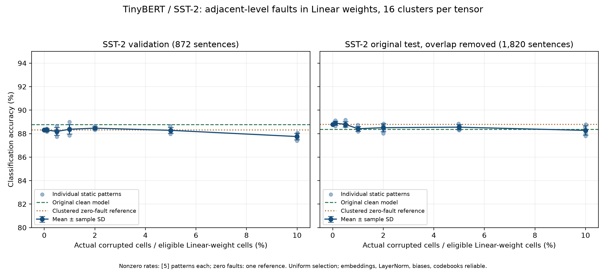
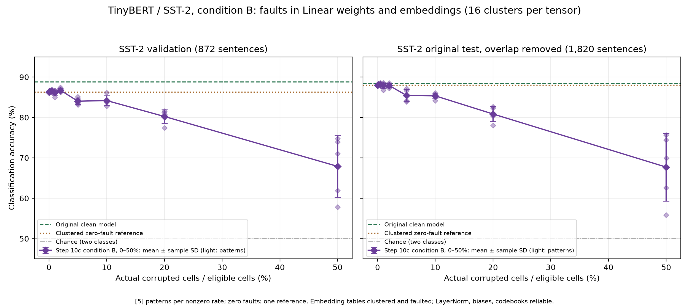

# Fault-Tolerant Neural Networks with Low-Rank Adaptation

This research project asks whether small trainable LoRA adapters can recover
performance lost when hardware memory faults corrupt a neural network's stored
weights. Dense memory can reduce parameter-storage area, but increasing the
number of distinguishable physical levels per cell can make reads less reliable.
The intended experiments will examine the tradeoff between storage efficiency,
model performance, and adapter overhead.

## Implementation status

Steps 1–8 are complete. Clean and k=16 clustered ResNet-18 baselines have been
evaluated on CIFAR-10, and their configurations, splits, preprocessing,
checkpoints/encodings, provenance, and measured results are saved locally. The
original clean checkpoint is preserved. A simplified adjacent-level simulator
has saved one static 1%-probability fault pattern and its reconstructed faulty
checkpoint. All eight full-model Step 6 audit checks and 51 unit tests pass.
Step 7 completed 31 static-pattern evaluations across seven probabilities, with
five patterns per nonzero rate, and saved individual measurements and plots.
Step 8 trained rank-4 LoRA adapters for five epochs on one saved 1% pattern,
with all base parameters and normalization buffers frozen. Its paired test
accuracy changed from 79.91% to 91.76%.
Step 9a generalized that recovery code to clean, clustered, and faulty bases,
added a batch runner and an evaluation-only adapter-transfer utility, and ran
no new training. Step 10a added the second model: a downloaded TinyBERT SST-2
classifier, evaluated with no fine-tuning at **88.76%** on the official
872-sentence validation split, with pinned model/data revisions and a saved
selection split. Step 10b applied the unchanged k=16 clustering and fault
simulator to TinyBERT's 26 Linear weights. Across 0–10% fault rates, mean
accuracy stayed within 0.55 percentage points of the clustered reference on
both test sets. Step 10c ran two harsher conditions. With faults in the Linear
weights at 20–100%, the mean drop reached about 18 points at 100%. With the
embeddings also clustered and faulted, at 0–50%, it reached about 18–20 points
at 50%. Step 10c also fixed the Part 7 fault rates with a rule that uses only
the selection split. Step 10d added the TinyBERT LoRA recovery code and ran one
CPU pilot on a 20% Condition B pattern. Test accuracy rose from 80.73% to 86.58%
(`sst2-validation-872`) and from 80.33% to 87.91% (`sst2-original-test-1820`).
The full Part 7 matrix is proposed, not run.

## Completed workflow

1. [Repository scaffold and Python environment](#step-1-repository-scaffold-and-python-environment)
2. [Dependencies and compute setup](#step-2-dependencies-and-compute-setup)
3. [Clean ResNet-18 baseline](#step-3-clean-resnet-18-baseline)
4. [Clustered-weight baseline](#step-4-clustered-weight-baseline)
5. [Fault simulation](#step-5-fault-simulation)
6. [Fault-injection correctness checks](#step-6-fault-injection-correctness-checks)
7. [Fault-rate experiments](#step-7-fault-rate-experiments)
8. [LoRA recovery](#step-8-lora-recovery)
9. [Generalized recovery runner (9a)](#step-9a-generalized-recovery-runner)
10. [TinyBERT / SST-2 clean baseline (10a)](#step-10a-tinybert--sst-2-clean-baseline)
11. [TinyBERT clustering and fault sweep (10b)](#step-10b-tinybert-clustering-and-fault-sweep)
12. [Harsher TinyBERT fault conditions (10c)](#step-10c-harsher-tinybert-fault-conditions)
13. [TinyBERT LoRA recovery code and pilot (10d)](#step-10d-tinybert-lora-recovery-code-and-pilot)

## Step 1: Repository scaffold and Python environment

**Purpose:** establish an organized repository and a usable local Python environment.

We created the package layout, empty package initializers, configuration/script/test
folders, `.gitignore`, and the initial README. Git was initialized for the project.
A usable project-local `.venv` was inspected and reused; its executable reports
**Python 3.11.4**. System Python was not changed. Model code and experiments were
added only in the later steps documented below.

### Project structure

| Path | Purpose |
| --- | --- |
| `src/fault_lora/` | Root Python package for the research workflow. |
| `src/fault_lora/models/` | ResNet-18 loading and checkpoint restoration; convolutional and linear LoRA adapters; pinned TinyBERT loading and layer layout. |
| `src/fault_lora/data/` | Dataset preparation, preprocessing, and split handling for CIFAR-10 and SST-2. |
| `src/fault_lora/memory/` | Scalar clustering, codebooks, typed indices, reversible physical mappings, and static adjacent-level patterns; future shared component integration. |
| `src/fault_lora/evaluation/` | Classification metrics for tensor and dict-of-tensor batches, artifact audits, controlled comparisons, fault-rate plots, and the TinyBERT clean evaluation. |
| `src/fault_lora/training/` | Clean CIFAR-10 fine-tuning, adapter-only recovery training on any base, the recovery matrix runner, and adapter-transfer evaluation. |
| `configs/` | Baseline, fault-generation, audit, sweep, and LoRA recovery configurations. |
| `scripts/` | Environment checks, baselines, fault generation/audits, sweeps, LoRA recovery, and the recovery matrix. |
| `tests/` | Offline baseline, representation, and integrity checks. |
| `docs/figures/` | Repository copies of verified Step 7, Step 8, Step 10b, and Step 10c PNG/PDF figures embedded in this README. |
| `results/` | Generated measurements and plots; ignored by Git. |
| `checkpoints/` | Pretrained weights, clean/decoded checkpoints, clustered encodings, sparse patterns, and adapter-only checkpoints; `hf-cache/` holds the pinned TinyBERT files; ignored by Git. |
| `data/` | Downloaded CIFAR-10 files and, under `hf-cache/`, the pinned SST-2 files; ignored by Git. |
| `.venv/` | Local Python virtual environment; ignored by Git. |
| `requirements.txt` | Exact versions of the seven direct dependencies. |
| `requirements-macos-arm64.lock.txt` | Platform-specific versions and wheel hashes for all resolved dependencies. |

The root-anchored `/data/` ignore rule excludes downloaded datasets while
preserving the source package `src/fault_lora/data/`. Generated-output directories
are ignored; the selected README figures are copied into `docs/figures/`.

### Virtual environment

From the project root, activate the environment in the detected zsh shell:

```sh
source .venv/bin/activate
```

The same activation command works in bash. Verify or invoke the environment
explicitly, without relying on activation persisting across separate shells:

```sh
.venv/bin/python --version
```

For a fresh checkout without a `.venv`, use an existing Python 3.11 interpreter
to reproduce this dependency environment. Inspect any existing environment
before creating one:

```sh
python3.11 --version
python3.11 -m venv .venv
source .venv/bin/activate
.venv/bin/python --version
```

**Verification:** required directories and initializers existed, the environment's
Python executable worked, and generated datasets/checkpoints/results and `.venv/`
were ignored while `src/fault_lora/data/` remained available to track.

## Step 2: Dependencies and compute setup

**Purpose:** install compatible dependencies and verify the available compute devices.

We installed the core libraries into the existing `.venv`, pinned the direct
versions, and generated the macOS arm64 / CPython 3.11 lockfile with wheel hashes.
CPU and MPS tensor execution were verified before model experiments began.

| Package | Installed version | Implemented role |
| --- | --- | --- |
| PyTorch (`torch`) | 2.14.1 | Tensor operations, ResNet training, and inference. |
| `torchvision` | 0.29.1 | ResNet models, CIFAR-10 datasets, and preprocessing. |
| NumPy | 2.4.6 | Array handling and experiment data. |
| scikit-learn | 1.9.1 | Per-tensor weight clustering. |
| Matplotlib | 3.11.2 | Validation/test fault-rate plots. |

These versions were selected by resolving compatible binary wheels for the
actual environment and verifying them together. Step 10a added `transformers`
5.19.0 and `datasets` 5.1.0 and regenerated the lockfile, which now pins 64
packages; the 28-package count below describes the original Step 2 lockfile.
PEFT is not used: the adapters are this repository's own.

On a matching macOS arm64 / CPython 3.11 environment, install the full lockfile:

```sh
.venv/bin/python -m pip install --index-url https://pypi.org/simple --only-binary=:all: --require-hashes -r requirements-macos-arm64.lock.txt
.venv/bin/python -m pip check
.venv/bin/python scripts/check_environment.py
```

The lockfile pins all 28 resolved packages, including transitive dependencies
and the setuptools version required by PyTorch, with their exact wheel hashes.
Pip itself is not pinned. The native macOS wheels require macOS 14 or later.
This lockfile is specific to CPython 3.11 on macOS arm64; another platform or
Python minor version needs its own resolution and verification. The shorter
`requirements.txt` records direct versions, but does not lock transitive versions
or wheel hashes. A Linux/CUDA environment has not been configured or tested.

The check prints a JSON report of the Python/platform versions, package
versions, backend availability, selected device, and verification results.
It imports all five libraries, checks the headless Matplotlib Agg backend,
tests the NumPy/PyTorch bridge, performs tiny float32 matrix multiplications on
CPU and the selected device, and exercises a compiled torchvision operator on
CPU. It does not instantiate models, download anything, train, evaluate datasets,
or write plots. Import and tensor failures cause a nonzero exit status.

For an explicit device check:

```sh
.venv/bin/python scripts/check_environment.py --device cpu
.venv/bin/python scripts/check_environment.py --device mps
```

Automatic selection chooses an available CUDA device, then MPS, then CPU. An
explicit unavailable device fails rather than silently switching devices.

### Local compute

The inspected machine is an Apple M3 Pro MacBook Pro running macOS 26.6, with
11 CPU cores, a 14-core Apple GPU, and 18 GB of unified memory. Python runs
natively as arm64. The installed PyTorch build includes MPS and has no available
CUDA backend on this machine.

Library imports, CPU tensor checks, and the compiled torchvision operator check
passed. MPS was unavailable inside the Codex sandbox, but an explicit MPS check
outside the sandbox passed, including GPU matrix multiplication and transfer
back to CPU. Both CPU and MPS execution are verified; run future GPU workflows
in a process that has GPU access.

PyTorch's [MPS backend](https://docs.pytorch.org/docs/2.14/notes/mps.html) provides
GPU tensor execution through Apple's Metal framework. Backend availability must
be checked in the process that will run the experiment; restricted execution
environments may hide GPU access. These installation checks do not establish
model throughput, training capacity, or compatibility of every model operator.

## Step 3: Clean ResNet-18 baseline

**Purpose:** fine-tune an ImageNet-pretrained ResNet-18 for CIFAR-10 and save a reproducible clean reference.

The selected workflow is CIFAR-10 with torchvision's
[ImageNet-pretrained ResNet-18](https://docs.pytorch.org/vision/stable/models/generated/torchvision.models.resnet18.html)
(`IMAGENET1K_V1`). Its final classifier is replaced with a ten-class linear
layer, and all model parameters are fine-tuned. The original convolutional stem
and max-pooling are preserved. This is a target-dataset baseline, not a direct
evaluation of an ImageNet classifier on CIFAR-10.

The initial configuration uses seed 42 and five epochs of SGD with momentum
0.9 and weight decay 0.0005. Backbone and classifier learning rates start at
0.001 and 0.01, respectively, with cosine decay. Training batch size is 128 and
evaluation batch size is 256. This bounded initial recipe is not claimed to be
an optimized CIFAR-10 result.

The completed run selected epoch 5 using validation performance and measured:

| Split | Examples | Correct | Accuracy | Mean cross-entropy |
| --- | ---: | ---: | ---: | ---: |
| Validation | 5,000 | 4,622 | 92.44% | 0.2180 |
| Official test | 10,000 | 9,228 | 92.28% | 0.2299 |

These are actual local measurements from the saved checkpoint, not published
ResNet reference numbers. The initial download/training/evaluation run took
421.4 seconds on MPS. Results describe one seeded run with the documented
96×96 preprocessing; they do not establish variability across training seeds.

The official 50,000-image training set is split into 45,000 training images and
5,000 validation images, reserving 500 per class. The explicit indices are saved.
The official 10,000-image test set is separate and is evaluated once, after all
epochs and validation-only selection of the checkpoint. Selection uses highest
validation accuracy, then lowest validation cross-entropy loss; exact ties
retain the earlier epoch. No test measurements affect checkpoint selection.

Training uses random 32-pixel crops with four pixels of padding and horizontal
flips. Images are then resized directly to 96×96 and normalized with ImageNet
mean/std. Evaluation uses the same resize and normalization with no random
augmentation. **This resolution and direct resizing differ from the pretrained
weights' default 256-resize/224-center-crop preprocessing.** They are saved as an
explicit choice for the local baseline and must remain fixed in later controlled
comparisons. Accuracy is reported as a fraction; cross-entropy is averaged over
examples, including incomplete final batches.

Run from the project root in a process with MPS and network access:

```sh
.venv/bin/python scripts/run_clean_baseline.py --config configs/resnet18_cifar10.json --download
```

`--download` permits downloading CIFAR-10 when missing. The pretrained ResNet-18
weights are cached under `checkpoints/torch-cache/`. Existing dataset files are
integrity-checked by torchvision. Change the configuration's `device` to `cpu`
to run without GPU access; an unavailable explicitly selected device fails.
Change `run_id` for a new run. The command refuses to overwrite existing run
directories. A failed or interrupted run has a status record and may retain
completed-epoch checkpoints; it is not presented as a completed baseline.
`last.pt` stores model weights, not an optimizer-resume state; reproduction
starts a fresh run with the saved configuration.

Artifacts for this run are saved under:

- `checkpoints/resnet18-cifar10-clean-seed42/best.pt`: validation-selected clean
  model, architecture, class order, preprocessing, provenance, and metadata.
- `checkpoints/resnet18-cifar10-clean-seed42/last.pt`: final completed epoch's
  weights and metadata.
- `results/resnet18-cifar10-clean-seed42/`: configuration, split indices,
  preprocessing, environment, manifest, epoch history, status, and final metrics.

The manifest records dataset integrity information, pretrained-weight and split
hashes, and checkpoint selection policy. Final metrics include the selected
checkpoint's SHA-256 hash. Checkpoints can be restored with
`fault_lora.models.resnet.load_clean_checkpoint` without another model download.
Random generators and data-loader workers are seeded; identical bits across
different devices or library versions are not guaranteed. Generated data,
checkpoints, and results remain ignored by Git.

The completed initial run also has `source_sha256.json`, recording hashes of the
source, configuration, and dependency files used for that run. The selected
checkpoint hash is
`7a9d200cbce14c01ddadb68c3a94ce8a9a7990a4cfcdfb7d9f5ae4bdfac47439`.
Seven offline correctness checks passed.

Offline checks require no model or dataset downloads:

```sh
.venv/bin/python -m unittest discover -s tests -v
```

## Step 4: Clustered-weight baseline

**Purpose:** store weights using codebooks and indices, then measure clustering loss with zero faults.

The implemented representation groups similar scalar weights into clusters within
each eligible layer. Representative values form a lookup table, or codebook;
each weight position stores an index into that table. For example, a weight of
0.113 might be represented by 0.10 at codebook index 2. A memory read decodes the
stored index and retrieves its representative weight.

Two sources of performance loss must be measured separately:

- **Clustering (compression) loss:** replacing the original weights with
  representatives can change predictions even when every read is correct.
  Compare the original model with the clustered, fault-free model.
- **Fault loss:** incorrect reads cause additional substitutions. Compare the
  clustered, fault-free model with the same representation under faults.

The first configuration uses **16 clusters per eligible weight tensor** with
seed 42. Eligible tensors are all 21 ResNet-18 Conv2d/Linear weights, including
the stem, residual projection convolutions, and classifier: 11,172,032 scalar
weights in total. Biases, batch-normalization parameters, running statistics,
and counters are retained exactly from the clean model. The source is the saved
Step 3 validation-selected checkpoint; no additional training occurs.

The completed paired evaluation measured:

| Split | Clean accuracy | Clustered, zero-fault accuracy | Accuracy drop |
| --- | ---: | ---: | ---: |
| Validation (5,000 images) | 92.44% | 83.34% | 9.10 percentage points |
| Official test (10,000 images) | 92.28% | 83.29% | 8.99 percentage points |

The clustered test model made 8,329 correct predictions, with mean cross-entropy
0.5055 versus the clean model's 0.2299. The clean replay reproduced Step 3's
counts and losses exactly. This is measured clustering/compression loss with
zero faults, not fault loss. Sixteen representatives across all selected tensors
caused a substantial accuracy reduction in this experiment. This single-seed
result does not establish that other counts or layer selections behave the same
way. The clustering and paired evaluation run took 87.4 seconds.

`memory/clustering.py` fits scalar
[scikit-learn KMeans](https://scikit-learn.org/stable/modules/generated/sklearn.cluster.KMeans.html)
independently per tensor using every weight, Lloyd's algorithm, k-means++
initialization, three initializations, a 100-iteration limit, and tolerance
0.0001. Tensor ordinal is added to the run seed to obtain a recorded per-tensor
seed. Four CPU threads are used. Local k-means solutions are not claimed to be
globally optimal. Each codebook is sorted and its assignment labels are remapped
to preserve the decoded weights. A tensor with fewer distinct values than the
requested cluster count uses those exact distinct values and records its actual
codebook size.

The initial physical representation assumes one memory cell per index, with
identity index-to-level mapping into levels 0–15 for each 16-entry codebook.
Both mapping directions are saved, and decoding supports a different saved
permutation. A level change would select a different representative; the
representative's numerical difference need not be one. This is an initial
experimental assumption, not a hardware-calibrated encoding or an exact
reproduction of the reference paper. Codebooks and mapping metadata are assumed
reliable. Step 4 performs **no fault injection**.

Run with existing local CIFAR-10 data and access to MPS:

```sh
.venv/bin/python scripts/run_clustered_baseline.py --config configs/resnet18_cifar10_clustered.json
```

The runner verifies the clean checkpoint hash and saved split hash before
clustering. It saves an encoding containing codebooks, uint8 indices, physical
mappings, and all untouched state, then reloads that artifact and reconstructs
the model. Index decoding and physical-level decoding must agree. The source
model state and source checkpoint file are checked for preservation.

Clean and reconstructed clustered models are evaluated on the same saved
validation and official test splits with the exact Step 3 preprocessing and
evaluation batch size. The clean model is measured again in the same run so
that the reported accuracy difference uses matched conditions. The original
Step 3 clean measurements are also recorded, along with any difference in
correct prediction count. Cluster count is fixed in advance; the run does not
select a configuration using these evaluation results.

Artifacts are stored under
`checkpoints/resnet18-cifar10-clustered-k16-seed42/` and
`results/resnet18-cifar10-clustered-k16-seed42/`:

| Artifact | Purpose |
| --- | --- |
| `encoding.pt` | Self-contained codebooks, indices, physical mappings, untouched state, and metadata. |
| `clustered_dense.pt` | Dense reconstructed weights for ordinary ResNet inference; stored separately from the encoding. |
| `layers.json` | Per-tensor codebooks, mappings, occupancy, seeds, solver iterations, and weight errors. |
| `metrics.json` | Paired clean/clustered measurements, signed accuracy drop in percentage points, and cross-entropy increase. |
| `storage.json` | Actual tensor sizes, serialized file sizes, and separately labeled bit-packing estimates. |
| `manifest.json` | Tensor scope, assumptions, source provenance, algorithm, and evaluation settings. |
| Other JSON records | Configuration, source hashes, copied splits/preprocessing, environment, and completion status. |

Indices are actually stored as uint8 values, which use eight bits each. Sixteen
indices would need four bits each in an ideal packed layout, but bit packing is
not implemented. Storage estimates include codebooks, both mapping tensors,
and all untouched model state. Serialized file sizes also include archive and
metadata overhead. Ordinary inference uses reconstructed dense weights; the
encoded artifact does not establish smaller runtime memory, faster inference,
or hardware area/energy savings.

The measured original dense state contains 44,765,128 tensor bytes. The saved
representation contains 11,255,752 tensor bytes including codebooks, mappings,
and untouched state, a 3.98× tensor-size ratio. The actual serialized encoding
file is 11,312,844 bytes. The estimated packed representation would contain
5,669,736 bytes, but that layout has not been implemented.

Seventeen offline checks passed, including the original seven baseline checks.
New checks cover label remapping, deterministic encoding, exact handling of
constant/small tensors, reversible mappings, invalid representations, model
preservation, serialization, storage accounting, and source-integrity rejection.

## Step 5: Fault simulation

**Purpose:** simulate adjacent physical-level read errors and save a fixed fault pattern with exact counts.

The starting reference is [On-Chip Deep Neural Network Storage with Multi-Level
eNVM](https://www.eecs.tufts.edu/~mdonato/assets/papers/dac2018-envm.pdf)
(Donato et al., DAC 2018). Its fault model concerns reads into neighboring
physical levels, with probabilities depending on the cell configuration and
stored level.

An adjacent-level error changes a cell's physical level by one; it is distinct
from an arbitrary binary bit flip. The level-to-information mapping determines
which weight is retrieved. If an index spans multiple cells, a one-level change
in one cell need not change the complete index by one, and it never means adding
or subtracting one from the numerical weight.

A uniform-probability adjacent-level simulator is implemented as an explicit
simplification, not an exact reproduction of the reference paper. A saved,
static fault pattern means keeping the same corruption throughout an experiment;
it does not specify whether the mechanism uses neighboring levels or bit flips.

The initial configuration uses a **0.01 selection probability per eligible
cell**, seed 42, and the saved k=16 encoding from Step 4. The denominator is
11,172,032 scalar index cells across all 21 Conv2d/Linear weight tensors.
Codebooks, mappings, biases, and batch-normalization state remain reliable.
This is a uniform software model with one cell per index; its probabilities
are simplifying assumptions, not measurements or calibration from the paper.

Each cell is selected by a separate Bernoulli draw. The requested probability
does not force an exact count. For a selected interior level, up and down each
have probability 0.5. At the lowest level, the only transition is 0 → 1; at
the highest level, it is 15 → 14. Boundary events therefore always change the
physical state, with no wraparound or clipped no-op. More generally, a tensor
with K=1 has no neighboring state and is excluded from the denominator.

For the current K=16 representation:

| Stored level | Probability of correct read | Probability of reading one level lower | Probability of reading one level higher |
| --- | ---: | ---: | ---: |
| 0 | 0.99 | 0 | 0.01 |
| 1–14 | 0.99 | 0.005 | 0.005 |
| 15 | 0.99 | 0.01 | 0 |

The generated artifact contains these actual counts:

| Quantity | Recorded value |
| --- | ---: |
| Eligible cells | 11,172,032 |
| Expected selected count (N × p) | 111,720.32 |
| Actual corrupted cells | 111,858 |
| Realized fault rate | 1.001232% |
| Upward transitions | 56,326 |
| Downward transitions | 55,532 |
| Transitions from the lowest boundary | 292 |
| Transitions from the highest boundary | 89 |
| Changed decoded scalar weights | 111,858 |

Physical-cell changes and decoded-weight changes are recorded separately. They
match in this run because the selected transitions have distinct representatives;
they need not match if representatives tie. The ±1 transition refers to the
physical level, and the saved level-to-index mapping selects the resulting
codebook value. Its numerical weight difference need not be one. Overall
up/down counts need not be equal, especially with forced boundary directions.

`src/fault_lora/memory/faults.py` exposes `generate_fault_pattern`,
`summarize_fault_pattern`, and `apply_fault_pattern`. These functions take a
saved encoding and do not depend on datasets or training. Optional tensor
selection permits later sensitivity studies. Sampling uses an isolated CPU
`torch.Generator`, sorted tensor names, float64 uniform draws for selection,
and integer direction draws for the selected cells. The seed, algorithm,
tensor order, and PyTorch version are saved. A seed alone does not promise
identical sampling across library versions; the saved transitions are the
authoritative pattern for replay.

The pattern records flattened cell positions and their exact original and
destination levels. A semantic SHA-256 fingerprint binds it to the source
codebooks, indices, both mappings, and untouched state. Application validates
that fingerprint and the sparse transitions, then reconstructs an independent
dense state from the uncorrupted encoding. Replaying the same pattern does
not accumulate faults or modify its inputs. Static faults mean these saved
substitutions stay fixed throughout a later experiment; they are not resampled
on each inference call. The simulator does not currently model level-dependent
hardware error rates, multiple cells per index, or faults in reliable metadata.

Generate from existing local artifacts, using CPU only:

```sh
.venv/bin/python scripts/generate_fault_pattern.py --config configs/resnet18_cifar10_faults.json
```

The command refuses to overwrite existing run directories. Change `run_id`
for another generation, along with the desired probability and seed. It
verifies the recorded Step 4 encoding/dense hashes, exact decoding agreement,
and original clean-checkpoint hash before generating a pattern. It reloads
the saved pattern, creates a faulty checkpoint, restores that checkpoint,
checks exact tensor agreement and a finite `(2, 10)` CPU forward pass on
synthetic inputs, and confirms source artifact hashes are unchanged.

Artifacts are saved under
`checkpoints/resnet18-cifar10-faults-p001-seed42/` and
`results/resnet18-cifar10-faults-p001-seed42/`:

| Artifact | Purpose |
| --- | --- |
| `pattern.pt` | Exact sparse transitions, sampling choices, source fingerprint, seed, and static-model assumptions. |
| `faulty_dense.pt` | Reconstructed faulty ResNet state with preprocessing, classes, split provenance, and pattern/source hashes. |
| `counts.json` | Actual cell and weight changes, realized rate, per-tensor counts, directions, boundaries, and level histograms. |
| `manifest.json` | Source artifact paths/hashes, scope, assumptions, generated hashes/sizes, and artifact-check results. |
| Other JSON records | Configuration, environment, source-code hashes, and completion status. |

The serialized pattern occupies 1,135,910 bytes and the dense faulty checkpoint
44,806,091 bytes. These are software artifact sizes, not hardware overhead
measurements. Generation, persistence, and artifact checks took 0.52 seconds
after source validation. Twenty-four offline unit checks passed, including
seven new simulator checks for zero faults, neighboring transitions and
boundaries, nonidentity mappings, seeded replay, singleton exclusions, changed
weight accounting, malformed patterns, and invalid configuration.

**No dataset accuracy or loss was measured in Step 5.** The synthetic forward
check establishes that the saved model runs; it does not quantify damage.
Step 6 audited the complete ResNet artifacts; Step 7 measured fault
loss against the **83.29% clustered zero-fault test baseline**, keeping it
separate from the original clean model's 92.28% accuracy and clustering loss.

## Step 6: Fault-injection correctness checks

**Purpose:** verify the simulator and saved full-model artifacts before measuring fault damage.

The completed CPU audit checks the actual saved ResNet encoding, static pattern,
and faulty checkpoint across 21 clustered tensors, 11,172,032 eligible cells,
and all 122 model-state tensors. It supplements the small-tensor unit tests
with an independent decoding calculation in
`src/fault_lora/evaluation/fault_checks.py`. That calculation derives original
physical levels directly from stored indices and mappings, checks the sparse
transitions, and constructs expected weights by substituting only the selected
positions. It compares the entire reconstructed state, including all unselected
weights and reliable biases/normalization state, against the simulator output.

All eight audit checks passed:

| Check | Actual result |
| --- | --- |
| Source integrity | Recorded clean, clustered, pattern, and faulty-checkpoint hashes matched; the saved encoding reconstructed its clustered checkpoint exactly. |
| Zero faults | All 122 state tensors matched the clustered baseline; outputs for two seeded synthetic inputs were finite and exactly equal. |
| Saved pattern and checkpoint | All 111,858 transitions were valid neighbors; independent decoded weights and counts matched the saved checkpoint and count records. |
| Repeated application | Two applications to the baseline produced identical state without accumulating damage. |
| Same seed | Seed 42 regenerated every saved position, original level, and destination level exactly. |
| Different seed | Seed 43 produced a different valid pattern with 111,848 selected cells. |
| All-cell selection | p=1 selected all 11,172,032 eligible cells; every transition stayed within bounds and moved by exactly one physical level. |
| Source preservation | The in-memory baseline fingerprint and all input artifact hashes remained unchanged. |

The all-cell check exercised 28,240 lower-boundary transitions and 9,778
upper-boundary transitions, all moving inward. The zero-fault check used a
local input generator with seed 0 and ResNet in evaluation mode. The original
saved 1%-probability pattern and checkpoint were preserved. Temporary zero-fault,
all-cell, and alternate-seed patterns were used only for correctness checks and
were not saved as performance experiments.

Run the audit with existing local artifacts:

```sh
.venv/bin/python scripts/check_fault_injection.py --config configs/resnet18_cifar10_fault_checks.json
```

It refuses to overwrite the audit directory; use a new `run_id` for another
audit. Exact regeneration from the seed requires the recorded PyTorch version;
replaying saved transitions is checked separately. The audit records its own
configuration, environment, source-code hashes, status, and a detailed
`report.json` under `results/resnet18-cifar10-fault-checks-seed42/`. The completed
audit took 1.20 seconds after source loading and validation.

Thirty-one offline unit tests passed. Seven additional tests check that the
independent oracle detects wrong selected weights, changed unselected/reliable
state, invalid neighboring transitions, missing state tensors, and dtype changes;
they also cover nonidentity mappings, restricted tensor scope, pattern comparison,
and audit configuration validation.

These checks establish correctness for the implemented simplified mechanism
and the recorded artifacts. **No dataset performance was measured in Step 6.**
Hardware calibration remains separate. Step 7 evaluated accuracy across
fault probabilities and repeated patterns, always starting from the clustered
zero-fault baseline.

## Step 7: Fault-rate experiments

**Purpose:** measure performance across fault rates and independent patterns, producing the baseline for future LoRA recovery.


The left panel shows validation accuracy on 5,000 images; the right shows test
accuracy on 10,000 images. Light-blue points are individual static fault patterns;
dark-blue points and bars show the mean ± one sample standard deviation across
five patterns per nonzero rate. The green dashed line is the original clean
reference, and the orange dotted line is the clustered zero-fault reference.
The x-axis uses the actual fraction of eligible cells corrupted.

Clean test accuracy was **92.28%**. Clustering alone reduced it to **83.29%**;
at 10% fault probability, mean test accuracy was **64.07% ± 9.07 percentage
points** across five patterns. These measurements use the simplified uniform
adjacent-level simulator with 16 clusters per weight tensor. They establish the
damaged-model baseline for the next step: training LoRA adapters and comparing
before/after recovery on the same saved fault patterns. Recovery is not yet
implemented.

[Download the PDF figure](docs/figures/resnet18-cifar10-step7-fault-sweep.pdf).
Detailed measurements and the method follow below.
The README figure files are repository assets copied from the verified run;
generated experiment outputs remain under the ignored `results/` directory.

### Measured results

The completed MPS sweep measured the following results. Uncertainty is sample
standard deviation across five fault patterns, expressed in percentage points;
the zero-fault row is one deterministic reference.

| Selection probability | Mean corrupted cells | Validation accuracy, mean ± SD | Test accuracy, mean ± SD | Additional test accuracy drop from clustered reference |
| --- | ---: | ---: | ---: | ---: |
| 0% | 0 | 83.34% (reference) | 83.29% (reference) | 0.00 pp |
| 0.1% | 11,199.8 | 83.15% ± 0.54 pp | 82.89% ± 0.53 pp | 0.40 pp |
| 0.5% | 55,954.0 | 82.84% ± 1.47 pp | 82.38% ± 1.40 pp | 0.91 pp |
| 1% | 111,569.0 | 81.12% ± 2.46 pp | 80.53% ± 2.44 pp | 2.76 pp |
| 2% | 223,478.0 | 80.48% ± 4.28 pp | 79.97% ± 4.21 pp | 3.32 pp |
| 5% | 558,662.2 | 78.11% ± 5.26 pp | 77.77% ± 5.01 pp | 5.52 pp |
| 10% | 1,117,265.8 | 64.40% ± 9.40 pp | 64.07% ± 9.07 pp | 19.22 pp |

Mean accuracy decreased across these predeclared rates, while pattern variation
increased. At 10%, test accuracy ranged from 49.09% to 73.16%. Some individual
patterns improved on the clustered reference: the 5% pattern with seed 64
achieved 85.35% test accuracy, while that rate's five-pattern mean was 77.77%.
These observations describe one trained checkpoint and five sampled patterns
per nonzero rate; they do not establish that faults generally improve accuracy
or that the means would remain identical with more patterns.

The clean replay reproduced 92.44% validation and 92.28% test accuracy, and the
clustered replay reproduced 83.34% and 83.29%, with the prior counts and losses.
The 8.99 pp clean-to-clustered test drop remains compression loss; the 19.22 pp
mean additional drop at 10% is fault loss. The run took 191.6 seconds after
source validation, including plotting. All 31 saved patterns, 62 validation/test
records, CSV records, means/sample standard deviations, plot hashes, prior
source hashes, and input artifact hashes were verified. The exported PNG was
visually inspected. These checks are recorded in `verification.json`.

The initial sweep uses selection probabilities of 0%, 0.1%, 0.5%, 1%, 2%, 5%,
and 10%. Each nonzero probability has five independent static patterns. The
zero-fault model is evaluated once because it is a deterministic reference,
giving 31 pattern evaluations in total. Nonzero patterns use unique seeds
42–71, allocated in ascending rate order; the zero pattern uses seed 42 with
no corrupted cells. Rates and seeds are declared before evaluation.

Every pattern is applied to the same uncorrupted k=16 encoding. The complete
reconstructed model state is loaded before evaluation, including all reliable
state, so faults do not accumulate across runs. The exact sparse pattern is
saved and reloaded before use, and stays fixed for both validation and test.
Clean and clustered zero-fault references are replayed in the same run.
Compression loss is recorded separately from the signed additional fault loss
relative to the clustered reference. Negative fault-loss values are retained
if a particular pattern improves accuracy; monotonic degradation is not assumed.

The saved 5,000-image validation split and official 10,000-image test split,
96×96 preprocessing, and evaluation batch size 256 are preserved. Both splits
are evaluated for every pattern, using MPS and no training or augmentation.
Test results characterize the predeclared sweep; they do not select weights,
rates, seeds, or hyperparameters. The completed Step 6 audit and the hashes
of its input artifacts are checked before the sweep starts.

Run with existing local data and MPS access:

```sh
.venv/bin/python scripts/run_fault_sweep.py --config configs/resnet18_cifar10_fault_sweep.json
```

Choose a new `run_id` for another sweep; existing output directories cannot be
overwritten. For CPU execution, explicitly set `device` to `cpu`. An unavailable
explicit device fails. Individual measurements and completion progress are saved
after every pattern; a failed/interrupted run is labeled and retains its finished
records. The current command starts a fresh run and does not resume partial runs.

The run saves artifacts under
`results/resnet18-cifar10-fault-sweep-seed42/` and
`checkpoints/resnet18-cifar10-fault-sweep-seed42/`:

| Artifact | Purpose |
| --- | --- |
| `plan.json` | Predeclared probabilities, unique pattern seeds, and pattern IDs. |
| Checkpoint `patterns/*.pt` | Exact sparse transitions and source fingerprints for every pattern, including zero. |
| Result `patterns/*.json` | Each pattern's actual cell/weight changes, per-layer counts, validation/test metrics, signed fault losses, and pattern hash. |
| `measurements.json` / `measurements.csv` | All individual measurements; one CSV row per pattern and split. |
| `aggregate.json` | Per-rate means, sample standard deviations, minima, maxima, seeds, actual counts/rates, accuracies, losses, and fault losses. |
| `references.json` | Replayed clean/clustered metrics and differences from Steps 3/4. |
| `accuracy_vs_fault_rate.png` / `.pdf` | Exportable two-panel validation/test figure. |
| `verification.json` | Post-run consistency checks for all patterns, measurements, aggregation, CSV records, plots, and source preservation. |
| Other JSON records | Configuration, splits, preprocessing, environment, source-code hashes, provenance, source preservation, and status. |

The plots use **actual corrupted cells divided by eligible cells**, expressed
as a percentage, on the x-axis. They show individual patterns and per-rate
mean accuracy with ±1 sample standard deviation (ddof=1). This describes variation
over fault patterns on a fixed trained model and fixed dataset; it is neither a
confidence interval nor variation over training seeds. The single zero-fault
reference has no estimated standard deviation (`null` in the aggregate). The
original clean and clustered zero-fault accuracies are distinct reference lines.
The accuracy axis is bounded from the observed values and labeled in percent.

Only sparse patterns are duplicated per run. Dense faulty weights can be
reconstructed with `apply_fault_pattern(source_encoding, saved_pattern)` when
needed for recovery. The source encoding, clean checkpoint, original Step 5
pattern, and all previously audited artifacts are preserved. The experiment
continues to use uniform adjacent-level probabilities and one cell per index;
it is not a hardware-calibrated result.

## Step 8: LoRA recovery

**Purpose:** test whether a small trainable adapter can improve predictions from
one model affected by a saved, fixed fault pattern while preserving its base state.

The first experiment used `rate03-seed52`, the first saved pattern at p=0.01 in
Step 7's declared order. It was chosen by order, rather than by its accuracy.
This pattern corrupts **111,322 of 11,172,032 eligible cells**
(actual rate **0.996435%**). The same substitutions
remain fixed during training, validation, and both sides of the test comparison.

### Adapter architecture and training

We added rank-4 adapters to **all 21 Conv2d/Linear layers**, including the stem,
residual convolutions, projection shortcuts, and classifier. Scaling uses
alpha=4, so alpha/r=1. Linear layers compute:

```text
h = W_faulty x + (alpha / r) B(Ax)
```

For convolutions, A maps input channels to four channels using the original
kernel, stride, padding, and dilation; B is a bias-free 1×1 convolution mapping
those four channels to the original output width. The effective kernel update,
flattened as output channels by input patch entries, has rank at most four.
The base and adapter outputs are added before the existing normalization and
activation. Both adapter branches have no bias or dropout. A starts with Kaiming
initialization and B starts at zero, making the initial adapter output zero.
This full-model identity was checked with exact synthetic logits and the saved
validation result before training.

All original weights, biases, BatchNorm affine parameters, running means,
running variances, and counters were frozen. The model stays in evaluation mode
while gradients remain enabled for A and B. This prevents BatchNorm updates
from contributing to recovery. Exact equality of **all 122 base state tensors**
was checked after every epoch and after selected-checkpoint evaluation.

Training reused the original **45,000 training / 5,000 validation / 10,000 test**
partition and 96×96 preprocessing. Training retained random crops and flips;
validation/test used deterministic preprocessing. The recipe was five epochs,
batch size 128, AdamW learning rate 0.001, weight decay 0.0001, cosine scheduling,
gradient-norm clipping at 1.0, and adapter/data seed 42 on Apple MPS.
No additional packages, models, or datasets were downloaded.

Checkpoint selection used highest validation accuracy, then lowest validation
cross-entropy; exact ties retain the earlier epoch. The initial zero-output
adapter (epoch 0) also competed. **Epoch 3 was selected.**
The test comparison ran only after selection, once for the selected adapter and
once for the same faulty base with the initial zero-output adapter restored.

### Measured recovery

| Split | Same faulty model before LoRA | After selected LoRA | Accuracy gain |
| --- | --- | --- | --- |
| Validation | 80.26% | 92.32% | +12.06 pp |
| Test | 79.91% | 91.76% | +11.85 pp |

Test cross-entropy changed from
**0.602161 to 0.238646**.
For context, the original clean test reference remains **92.28%** and the
clustered zero-fault reference remains **83.29%**. The before-LoRA value is this
individual pattern's paired baseline, rather than the average of Step 7's five
1% patterns.


[Download the PDF figure](docs/figures/resnet18-cifar10-step8-lora-recovery.pdf)

The left panel shows validation accuracy at epoch 0 and after each training
epoch; the star marks the selected checkpoint. The right panel compares the
same test pattern before and after LoRA. Horizontal lines show the previously
measured clean and clustered references. This is **one fault pattern and one
training seed**, so the plot has no uncertainty bars.

The adapters contain **145,780 trainable parameters**, or
**1.304%** of the 11,181,642 frozen base
parameters. Their float32 tensors occupy **583,120 bytes**
(569.45 KiB), while the selected serialized checkpoint occupies
606,741 bytes including metadata and archive overhead. Training plus
per-epoch validation took 243.8 seconds; the full run including
paired evaluation, reload checks, and plot export took 282.9 seconds.
These are software measurements on this machine. Adapters use reliable storage
and remain separate residual branches; compressed-runtime inference, hardware
storage area, and inference speed gains have not been measured.

### Why might recovery be this effective?

The result is plausible because the adapters started from a trained network
that still classified most images correctly and learned against one fixed
fault pattern. The following explanations are hypotheses supported by the
experiment's setup; their individual contributions have not been measured:

1. **Useful features may have survived.** The base had already been pretrained
   on ImageNet and fine-tuned on CIFAR-10. Clustering approximated its weights,
   and this pattern changed approximately 1% of the stored indices. Its 79.91%
   starting test accuracy suggests substantial useful information remained.
2. **Small updates act throughout the network.** Rank 4 was applied to all
   21 convolutional and linear layers, providing 145,780 trainable parameters.
   Corrections at multiple layers can jointly change predictions. Training
   optimizes classification, so it does not require exact reconstruction of
   every original weight.
3. **The correction target was stable.** The same faulty weights were used for
   every training batch and evaluation. Adapter parameters were treated as
   reliable. Transfer to different patterns or changing faults was not tested.
4. **The adapters received additional supervised training.** Five epochs on
   45,000 labeled images provided an opportunity to improve task performance.
   We have not separated that benefit from compensation for clustering and
   faults.

The accuracy changes make the attribution issue explicit:

| Stage | Test accuracy | Change from preceding stage |
| --- | --- | --- |
| Original clean model | 92.28% | — |
| Clustered model, zero faults | 83.29% | −8.99 pp |
| Selected static fault pattern | 79.91% | −3.38 pp |
| Same pattern with trained LoRA | 91.76% | +11.85 pp |

**The 11.85-point gain measures improvement from the combined clustered and
faulty starting model.** It exceeds the 3.38-point drop caused by this fault
pattern alone, so the entire gain cannot be attributed specifically to fault
compensation. The adapted result remained 0.52 points below the original clean
test reference.

The audit confirmed preservation of all 122 base state tensors, and the selected
validation accuracy (92.32%) was close to test accuracy (91.76%). These checks
support the reported measurement. They do not establish the cause of recovery
or its consistency across patterns and training seeds.

Step 9 should use the same adapter architecture and training budget on clean
and zero-fault clustered models, repeat recovery across saved patterns and
training seeds, and evaluate adapters on unseen patterns. These controls will
help distinguish additional task training, compensation for clustering, and
compensation for faults. They have not been run.

### Commands, files, and verification

Run a fresh experiment from the project root with:

```zsh
.venv/bin/python scripts/run_lora_recovery.py --config configs/resnet18_cifar10_lora.json
```

Existing output directories are preserved; choose a new `run_id` in a copied
configuration for another run. Rank, alpha, layer names, pattern, seed, and
training recipe are explicit configuration fields. `target_names: null` selects
all Conv2d/Linear layers; a list selects specific existing layers. Grouped
convolutions are rejected by this implementation.

- `src/fault_lora/models/lora.py`: convolutional/linear residuals, adapter-only
  state loading, and reconstruction of original base state names.
- `src/fault_lora/training/recovery.py`: source audits, frozen-state training,
  validation selection, checkpoint reconstruction, paired evaluation, and plots.
- `tests/test_lora_recovery.py`: seven offline checks covering effective-kernel
  equivalence, zero-output identity, gradient isolation, normalization buffers,
  checkpoint reloads, invalid input, and a complete temporary recovery workflow.

Generated results are in
`results/resnet18-cifar10-lora-r4-p001-seed52-train42/`: configuration, source
hashes, environment, original splits/preprocessing, fault counts, adapter layout,
epoch history, before/after metrics, manifest, verification, and PNG/PDF plots.
Adapter-only `initial.pt`, `best.pt`, and `last.pt` are in the matching checkpoint
directory. Checkpoints record the exact source encoding/pattern hashes and
adapter architecture; `load_recovered_model(checkpoint_path, project_root)`
reconstructs the faulty base and loads the saved adapters without downloads.
These are evaluation checkpoints; optimizer state for interrupted-run resume
is not saved. The code and inputs from Steps 3–7 were verified unchanged.

The full offline suite passes **44 tests**. The completed run also verified
zero-output identity, base preservation each epoch, exact selected-adapter logits
on reload, consistency of the validation selection and metrics, and preserved
source artifacts. The adapter design applies the frozen-base low-rank principle
from the [LoRA paper](https://arxiv.org/abs/2106.09685) to this ResNet convolution
geometry; it is not a replication of the paper's Transformer experiments.

## Step 9a: generalized recovery runner

**Purpose:** let the unchanged Step 8 LoRA recipe run on any base, so later
controls can separate additional task training, clustering repair, and fault
repair. **This step ran no training and measured no new accuracy.**

### Method

`RecoveryConfig` gained two fields; every other field and default is unchanged,
so `configs/resnet18_cifar10_lora.json` still loads and means what it did.

| Field | Values | Meaning |
| --- | --- | --- |
| `base_kind` | `"clean"`, `"clustered"`, `"faulty"` (default) | Which frozen state the adapters are attached to. |
| `pattern_id` | saved Step 7 ID, or `null` | Required for `"faulty"`; must be `null` otherwise. |
| `clean_checkpoint_sha256` | 64 hex characters, or `null` (default) | Optional pin; when set, the clean checkpoint must hash to it for every base kind. |

`build_base_state` produces the frozen state:

| `base_kind` | Frozen base | Before-LoRA count must equal |
| --- | --- | --- |
| `clean` | Step 3 validation-selected checkpoint; its non-clustered tensors must equal the encoding's untouched state. | Step 7 clean replay |
| `clustered` | `decode_state` of the Step 4 encoding; no pattern applied. | Step 7 clustered zero-fault replay |
| `faulty` | `apply_fault_pattern` of the same encoding and the saved pattern: the Step 8 path. | That pattern's Step 7 record |

All three share the Step 8 source audit, splits, preprocessing, recipe, epoch-0
competition, validation-only selection, per-epoch exact-equality check of all
base tensors, paired test evaluation after selection, and saved artifacts. A
clean base has no stored cells, so its fault probability, corrupted-cell count,
and realized rate are recorded as `null`; a clustered base records zero.
`fault_counts.json` is written only for a faulty base.

`scripts/run_lora_matrix.py` takes a configuration whose `runs` list declares
each run as exactly `base_kind`, `pattern_id`, `rank`, `alpha`, and `seed`; the
shared recipe fields sit beside the list. Run IDs follow
`resnet18-cifar10-lora-{base}-{pattern or none}-r{rank}-train{seed}`. Alpha is
not part of the ID, so two runs differing only in alpha are rejected. Before
anything is created, the runner rejects an existing matrix directory, any
existing run directory, and any pattern that is not a saved nonzero Step 7
pattern. It then executes each run as an independent `run_recovery` call with
its own result and checkpoint directories, rewrites the summary and status
after every run, and stops at the first failure, recording the failed run ID.
It never skips or resumes a run.

`evaluate_adapter_on_base(adapter_checkpoint, base_kind, pattern_id, project_root)`
loads a saved adapter onto a possibly different base and returns
validation/test metrics with the adapter and with its output zeroed. The split
hash, encoding fingerprint, architecture, classes, preprocessing, and complete
adapter layout must match the checkpoint. It trains nothing, selects nothing,
and writes nothing; `load_adapter_on_base` returns the model itself.

### Checks performed

No table of accuracies is reported because nothing was trained or evaluated on
CIFAR-10. The following were checked on the real saved artifacts, on CPU, with
synthetic inputs only:

| Check | Result |
| --- | --- |
| Step 7 pattern IDs | `rate01`–`rate06` are 0.1%, 0.5%, 1%, 2%, 5%, 10% with seeds 42–46, 47–51, 52–56, 57–61, 62–66, 67–71, as in `plan.json` and the 31 saved pattern files. |
| Clean checkpoint hash | `7a9d200cbce14c01ddadb68c3a94ce8a9a7990a4cfcdfb7d9f5ae4bdfac47439`; a different configured digest is rejected. |
| Base states | Each kind builds 122 tensors. Clean and clustered differ in 11,172,030 scalars; clustered and `rate03-seed52` differ in 111,322, that pattern's recorded corrupted-cell count. |
| Step 8 adapter | The saved `best.pt` (epoch 3) still loads through `load_recovered_model`; `load_adapter_on_base` on the same pattern gives exactly equal logits, and loading onto the clean, clustered, and `rate03-seed53` bases runs with finite, different logits. |
| Existing artifacts | SHA-256 of every file under `results/` and `checkpoints/` was identical before and after. |

### Commands and files

```zsh
.venv/bin/python scripts/run_lora_matrix.py --config configs/<matrix>.json
.venv/bin/python -m unittest discover -s tests -v
```

`--config` is required; no matrix configuration is committed yet because no
experiment has been declared. A configuration has this form:

```json
{
  "matrix_id": "resnet18-cifar10-lora-matrix-example",
  "clean_checkpoint_sha256": "7a9d200cbce14c01ddadb68c3a94ce8a9a7990a4cfcdfb7d9f5ae4bdfac47439",
  "runs": [
    {"base_kind": "clean", "pattern_id": null, "rank": 4, "alpha": 4.0, "seed": 42},
    {"base_kind": "clustered", "pattern_id": null, "rank": 4, "alpha": 4.0, "seed": 42},
    {"base_kind": "faulty", "pattern_id": "rate03-seed52", "rank": 4, "alpha": 4.0, "seed": 42}
  ]
}
```

Omitted shared fields take the Step 8 values (five epochs, batch size 128,
AdamW learning rate 0.001, weight decay 0.0001, cosine schedule, gradient
clipping 1.0, MPS).

- `src/fault_lora/training/recovery.py`: `base_kind`, `build_base_state`,
  `load_adapter_on_base`, and `evaluate_adapter_on_base`.
- `src/fault_lora/training/recovery_matrix.py`: `MatrixConfig`, `run_matrix`,
  and `verify_matrix`.
- `tests/test_lora_matrix.py`: seven offline checks on tiny synthetic models.

A matrix writes `results/<matrix_id>/`; each run writes the same files as Step 8
under its own run ID.

| Artifact | Purpose |
| --- | --- |
| `config.json` / `plan.json` | Declared matrix and the derived run IDs. |
| `summary.csv` / `summary.json` | One row per run: run ID, base kind, pattern, fault probability, corrupted cells, realized rate, rank, alpha, seed, selected epoch, before/after validation and test accuracy and cross-entropy, accuracy gains, trainable parameters, and seconds. |
| `status.json` | Completed and planned run counts; the failed run ID on failure. |
| `verification.json` | Post-run re-read of every run: completion, configuration, summary rows against saved metrics, CSV against JSON, selected epoch recomputed from validation records, checkpoint hashes, input artifact hashes, and source-code hashes. |
| Other JSON records | Environment, source-code hashes, and manifest with policies. |

The full offline suite passes **51 tests** (44 existing, 7 new). The new tests
cover the pattern-iff-faulty rule, loading the Step 8 configuration, the state
built for each base kind, invalid matrix configurations, a two-run toy matrix
with its summary and verification, rejection of unknown patterns and stopping
at the first failure, and transfer evaluation that is exact on the adapter's
own base and runs on other bases.

### Limitations

- No recovery run exists yet for a clean or clustered ResNet-18 base; the
  attribution question from Step 8 is still open.
- The before-LoRA check requires the exact Step 7 correct-prediction count, so a
  run on a device that reproduces different counts fails instead of proceeding.
- An interrupted matrix is not resumed. Its finished runs keep their
  directories, so the remaining runs need a new configuration and `matrix_id`.
- `evaluate_adapter_on_base` saves nothing; a transfer experiment still needs
  its own configuration, script, and saved records.
- Step 3–7 source files were not modified. `training/recovery.py` was, so its
  hash differs from the one recorded by the Step 8 run.

## Step 10a: TinyBERT / SST-2 clean baseline

**Purpose:** add a second model and task, a small text classifier, and fix its
data splits, tokenization, label order, and clean reference before any
clustering, fault, or LoRA experiment touches it. **Nothing was trained.**

### Model and data

| Item | Pinned source | Revision |
| --- | --- | --- |
| Model and tokenizer | [`Vishnou/TinyBERT_SST2`](https://huggingface.co/Vishnou/TinyBERT_SST2), a fine-tune of `huawei-noah/TinyBERT_General_4L_312D` | `5aa94d561e626f70a4380e2a51c786e64f3acad7` |
| Dataset | [`stanfordnlp/sst2`](https://huggingface.co/datasets/stanfordnlp/sst2) | `8d51e7e4887a4caaa95b3fbebbf53c0490b58bbb` |
| Candidate second test set | [`SetFit/sst2`](https://huggingface.co/datasets/SetFit/sst2) | `00ea8ccb7a54b4e3780a3e51aa3f80361ff849c0` |

Only full 40-character commit hashes are accepted; a branch or tag name is
rejected. The model and its tokenizer come from the same repository commit. Six
files are fetched (`config.json`, `model.safetensors`, the three tokenizer
files, and `vocab.txt`); the repository's pickled `training_args.bin` is not
downloaded. Model files are cached under `checkpoints/hf-cache/` and dataset
files under `data/hf-cache/`. The weight file `model.safetensors` is 57,411,808
bytes with SHA-256
`2b15f95bae36f14f3124420e8341531a6f4dc312b3d1fe5bf3e849480e39dcc4`; the
manifest records the size and hash of every downloaded file.

The model is a 4-layer, 312-wide `BertForSequenceClassification` with
**14,350,874 parameters**. `layers.json` records the name and shape of all
**26 `nn.Linear` and 3 `nn.Embedding`** modules:

| Module group | Count | Weight shape | Scalars |
| --- | ---: | --- | ---: |
| Word embeddings | 1 | 30,522 × 312 | 9,522,864 |
| Position embeddings | 1 | 512 × 312 | 159,744 |
| Token-type embeddings | 1 | 2 × 312 | 624 |
| Attention query / key / value / output, per layer | 16 | 312 × 312 | 1,557,504 |
| Intermediate, per layer | 4 | 1,200 × 312 | 1,497,600 |
| Output, per layer | 4 | 312 × 1,200 | 1,497,600 |
| Pooler | 1 | 312 × 312 | 97,344 |
| Classifier | 1 | 2 × 312 | 624 |

These weights total 14,333,904 scalars. The remaining parameters are 11,354
Linear biases and 5,616 LayerNorm values. Word embeddings alone are 66% of the
model. Which of these tensors become clustered memory cells is a later decision.

### Splits

GLUE's SST-2 test labels are hidden: all 1,821 are stored as -1. That split is
therefore unused, and the roles are:

| Split | Source | Examples | Negative / positive | Role |
| --- | --- | ---: | --- | --- |
| Selection | carved from the official train split | 5,000 | 2,211 / 2,789 | Every validation-only choice in later steps. |
| LoRA training | rest of the official train split | 62,349 | 27,569 / 34,780 | Adapter training in later steps; not evaluated here. |
| Test | official validation split | 872 | 428 / 444 | Reported only. Never used for any selection. |

The selection split is label-proportional over the 67,349 train examples
(29,780 negative, 37,569 positive) with largest-remainder rounding, drawn with
seed 42 by shuffling each label's indices with one NumPy generator. Indices are
row positions in the pinned train file, which equal its `idx` column. Both index
lists are saved in `splits.json`; its hash is
`f265c2d6ba992b5f0406f8a0671479dff067b1812c0f84ca4681a776310488fc`.

**The model card's 88.65% was reported on this same 872-sentence official
validation split**, which is the test split here. It is the only labelled
held-out SST-2 data in this dataset, so it cannot also serve for selection.

### Second test set: checked and not used

`SetFit/sst2` distributes the original SST-2 sentence-level splits with labels.
Its test split has 1,821 real labels (912 negative, 909 positive), and 1,731 of
its sentences equal sentences of GLUE's hidden-label test split. The rule,
fixed in code before any evaluation, admits it as `sst2-original-test` only if
its labels are real and no sentence also occurs in the SST-2 train or validation
split:

| Compared with | Byte-identical strings | Equal after whitespace normalization |
| --- | ---: | ---: |
| SST-2 train (67,349) | 0 | **1** |
| SST-2 validation (872) | 0 | 0 |

GLUE stores sentences with a trailing space, so byte comparison finds nothing
by construction; the meaningful comparison collapses whitespace. One test
sentence, `what 's next ?`, is also a train-split phrase. **The overlap is not
zero, so the set was skipped and no accuracy was measured on it.** The check
and the matching sentence are saved in `second_test_set.json`. Step 10b later
admitted this set with that one sentence removed, as a separate run.

### Tokenization

Each stored sentence is passed unmodified to the model's own tokenizer
(`BertTokenizer`, 30,522 entries) with special tokens, truncation at
`max_length` 128, and padding to the longest sentence in each batch. **No
sentence is truncated: 0 of 68,221 (0.00%)** across the selection, LoRA
training, and test splits. The longest is 66 tokens; means are 13.2
(selection), 13.3 (training), and 25.2 (test) tokens. The train split holds
phrases as well as sentences, which is why it is shorter.

### Label mapping

The mapping is **0 = negative, 1 = positive**. The model's `config.json` stores
no `id2label`, so `transformers` reports the generic `LABEL_0` / `LABEL_1` and
the configuration alone cannot confirm the order. It was confirmed instead by
three recorded checks, none of which uses a test split:

- the dataset's own label names are `["negative", "positive"]`;
- selection accuracy is 95.58% with this order and 4.42% with it reversed;
- two fixed probe sentences, one plainly negative and one plainly positive, are
  predicted as 0 and 1.

The run stops before evaluating any test set if these checks fail.

### Clean measurements

The downloaded checkpoint was evaluated as-is on CPU with batch size 256:

| Test set | Examples | Correct | Accuracy | Mean cross-entropy |
| --- | ---: | ---: | ---: | ---: |
| `sst2-validation-872` (official validation) | 872 | 774 | 88.76% | 0.5172 |

The test result is one sentence above the model card's 773 of 872 (88.65%,
loss 0.5142). The cause was not identified; a separate, unsaved diagnostic gave
774 at batch sizes 1, 8, 256, and 872 and with padding to 128 tokens, so
batching and padding do not explain it. The run took 16.2 seconds.

**Selection-split accuracy is not a held-out estimate for this checkpoint.**
Its publisher fine-tuned on the full SST-2 train split, which contains all 5,000
selection examples. The split is therefore used only for checkpoint selection
in later steps and is never reported as a result. It is held out from later
LoRA training only. Selection measurements are saved in each run's JSON
records for that purpose; the label-order check above also uses it.

Step 10b added the second test set, `sst2-original-test-1820`, in a separate
run; [its clean result](#step-10b-tinybert-clustering-and-fault-sweep) is
reported there.

### Evaluation function

`evaluate_sequence_classifier` in `evaluation/sequence_classification.py` is a
sibling of `evaluate_classifier` for dict-of-tensor batches. It removes the
labels, calls `model(**batch)`, accepts either a logits tensor or an output
with `.logits`, and returns the same four measurements with the same
example-weighted loss and mode restoration. Labels outside the class range,
such as GLUE's -1, raise an error instead of being scored.

`evaluate_classifier` itself was not edited. Steps 4–9 record the SHA-256 of
every file under `src/fault_lora/` and refuse to continue when a recorded file
has changed, so all Step 10a code is in new files and every earlier source file
is byte-identical.

### Commands, files, and verification

```zsh
.venv/bin/python scripts/run_tinybert_baseline.py --config configs/tinybert_sst2.json --download
.venv/bin/python -m unittest discover -s tests -v
```

`--download` fetches missing pinned files; without it nothing is fetched and a
missing file is an error. Existing run directories are never overwritten;
choose a new `run_id`. A failed or interrupted run keeps a status record.

- `src/fault_lora/models/tinybert.py`: pinned snapshot fetching, model and
  tokenizer loading, the Linear/Embedding layout, and `load_tinybert_checkpoint`.
- `src/fault_lora/data/sst2.py`: file reading, the proportional selection
  split, sentence-overlap counts, batch tokenization, and truncation counts.
- `src/fault_lora/evaluation/tinybert_baseline.py`: `TinyBertConfig`,
  `run_tinybert_baseline`, `check_second_test`, and `verify_tinybert_baseline`.
- `tests/test_tinybert_baseline.py`: 14 offline checks.

Artifacts are in `results/tinybert-sst2-clean-seed42/` and
`checkpoints/tinybert-sst2-clean-seed42/`:

| Artifact | Purpose |
| --- | --- |
| `clean.pt` | Downloaded weights, model configuration, classes, tokenization, split hash, and provenance; restores without a download. SHA-256 `eace4b3b8cb22e94151b3091b9a6b216afc1443d371cb449f68ba5d512d347f6`. |
| `metrics.json` | Selection and test counts, accuracy, cross-entropy, the model-card reference, and checkpoint/split hashes. |
| `splits.json` | Selection and LoRA-training indices, rule, seed, and the test-split definition. |
| `layers.json` | Name, type, and shape of every Linear and Embedding, with parameter totals. |
| `label_mapping.json` | The mapping, the stored and resolved `id2label`, and the three checks. |
| `truncation.json` / `preprocessing.json` | Token-length counts per split and the tokenization settings. |
| `second_test_set.json` | The SetFit/sst2 label and overlap check and its decision. |
| `manifest.json` | Repositories, revisions, downloaded-file sizes and hashes, split sizes and label counts, and policies. |
| `verification.json` | Post-run re-read of the records below. |
| Other JSON records | Configuration, environment, source-code hashes, and status. |

After the run, `verify_tinybert_baseline` re-read the saved files and passed:
the selection and training indices partition the 67,349 train rows and the
split hash agrees across records; every downloaded file still matches its
hash; **all 73 saved state tensors equal the downloaded `model.safetensors`
exactly**, which is the check that no fine-tuning occurred; the recorded layout
matches the restored model; measurement counts match the split sizes; the label
mapping is confirmed; and source code is unchanged. The restored checkpoint
also reproduced the original logits exactly.

Dependencies: `transformers==5.19.0` and `datasets==5.1.0` were added to
`requirements.txt`. The lockfile was regenerated from the installed
environment with wheel hashes and now pins 64 packages (28 before), all as
binary wheels; a `--require-hashes` resolution of the full lockfile and
`pip check` both pass. One existing pin changed: `fsspec` 2026.9.0 became
2026.7.0, because `datasets` 5.1.0 caps it. The full offline suite passes
**74 tests** (60 existing, 14 new). The new tests use a tiny randomly
initialized `BertForSequenceClassification`, a local vocabulary, and a
hand-built local cache, and download nothing. They cover agreement with a
direct calculation across batch sizes, mode and state preservation, tensor
outputs and custom label keys, rejection of empty batches and hidden labels,
padding and truncation, the split, the overlap counts, the second-test rule,
the layout, revision and configuration validation, a complete run with its
verification, exclusion of a leaking second test set, and stopping on a
reversed label order or a missing file.

### Limitations

- This is one downloaded checkpoint. Its training recipe is known only from
  its model card, and variability across fine-tuning seeds is not measured.
- The only held-out measurement is 872 sentences; one sentence is 0.11
  percentage points.
- The train split repeats some sentences, so the index partition is not a
  sentence partition: 59 of the 5,000 selection sentences also occur in the
  LoRA training split. Selection results in later steps are therefore slightly
  optimistic as estimates of held-out accuracy.
- Changing `requirements.txt` and the lockfile changes hashes that the ResNet
  runs recorded. Those runs live in a separate checkout and are unaffected,
  but after a merge the ResNet LoRA runner's check of the Step 7 sweep's
  recorded source hashes would reject the two dependency files.
- `memory/` and `models/lora.py` were not changed in this step. Clustering
  currently selects Conv2d/Linear weights only, so embeddings are not yet
  eligible cells.

## Step 10b: TinyBERT clustering and fault sweep

**Purpose:** repeat Steps 4–7 on TinyBERT with the same clustering algorithm
and fault simulator, measuring clustering loss and fault loss on two separately
reported test sets. **Nothing was trained.**

No existing source file was modified. `cluster_model`, `decode_state`,
`storage_estimates`, the fault simulator in `memory/faults.py`, the Step 6
oracle `inspect_transitions`, and the Step 7 `sweep_plan` are imported
unchanged by new sibling modules. Steps 3–10a record the SHA-256 of every
existing `src/fault_lora/` file and refuse to continue when one changes. All
runs used the CPU.

### Test sets and reporting

Every result below is reported per test set; the two are never pooled.

| Name | Source | Examples | Negative / positive |
| --- | --- | ---: | --- |
| `sst2-validation-872` | official SST-2 validation split (Step 10a's test split) | 872 | 428 / 444 |
| `sst2-original-test-1820` | `SetFit/sst2` test split at the pinned revision, one sentence removed | 1,820 | 912 / 908 |

The removed sentence is SetFit test row 1450, `what 's next ?` (label 1,
positive). It equals SST-2 train row 26,224 (`what 's next ? `, label 1) after
whitespace normalization, so it is not held out from the data the checkpoint
was fine-tuned on. The rule removes every SetFit test sentence whose
whitespace-normalized text matches any SST-2 train or validation sentence. No
other sentence matched. The removal, both matching rows, and a content hash of
each test set are saved in `test_sets.json` of every Step 10b run.

The selection split is measured in every run for later checkpoint selection
only. As noted in Step 10a, it is not a held-out estimate for this checkpoint
and is not reported as a result.

The clean checkpoint was first re-evaluated under a new run ID,
`tinybert-sst2-clean-twotest-seed42`. That run reproduced Step 10a's counts
exactly and added the second test set. The Step 10a run was left as it was.

| Test set | Correct | Clean accuracy | Mean cross-entropy |
| --- | ---: | ---: | ---: |
| `sst2-validation-872` | 774 / 872 | 88.76% | 0.5172 |
| `sst2-original-test-1820` | 1,608 / 1,820 | 88.35% | 0.5032 |

### Eligible cells: Linear weights only

`cluster_model`'s existing eligibility rule (Conv2d/Linear weights) was run on
the real checkpoint and selected exactly the **26 `nn.Linear` weights**, with
**4,650,672 eligible weights**. In each of the 4 layers these are the query,
key, value, attention-output, FFN-intermediate, and FFN-output weights, plus
the pooler dense and classifier weights. The run requires this list to equal
the model's Linear weights and records it in `scope.json`.

Kept exactly and treated as reliable storage, never clustered or faulted:

| Protected state | Tensors | Values | Share of 14,350,874 parameters |
| --- | ---: | ---: | ---: |
| Embedding tables (word, position, token type) | 3 | 9,683,232 | 67.5% |
| LayerNorm weights and biases | 18 | 5,616 | 0.04% |
| Linear biases | 26 | 11,354 | 0.08% |
| **Eligible Linear weights** | 26 | 4,650,672 | **32.4%** |

**The embeddings (9.68 million of 14.35 million parameters, 67.5%; the word
embeddings alone are 66.4%) are protected in this first condition.** The
fault-rate denominator therefore covers only the Linear weights: a 1% rate
corrupts about 46,500 cells, roughly 0.32% of all parameters. This differs from
ResNet-18, whose 21 Conv2d/Linear weights hold nearly every parameter.

### Clustering (Step 4 settings)

The source was the Step 10a checkpoint, whose SHA-256
`eace4b3b8cb22e94151b3091b9a6b216afc1443d371cb449f68ba5d512d347f6` is pinned in
the configuration and checked. Settings were unchanged from Step 4:

- 16 clusters per tensor, seed 42 plus the tensor ordinal;
- scalar Lloyd k-means with k-means++ initialization, 3 initializations, 100
  iterations, and tolerance 0.0001;
- sorted codebooks with an identity index-to-level mapping, one cell per index.

Every tensor received 16 representatives. The most iterations any tensor
needed was 75, so none reached the limit. Per-tensor relative L2 weight error
was 9.0%–20.0% (median 12.1%). The saved encoding reconstructs its dense
checkpoint exactly, and its untouched state equals the clean checkpoint.

| Test set | Clean | Clustered, zero faults | Clustering loss (clean − clustered) | Cross-entropy change |
| --- | ---: | ---: | ---: | ---: |
| `sst2-validation-872` | 88.76% (774) | 88.30% (770) | +0.46 pp | 0.5172 → 0.5123 |
| `sst2-original-test-1820` | 88.35% (1,608) | 88.79% (1,616) | **−0.44 pp** | 0.5032 → 0.4961 |

Clustering changed accuracy by 4 and 8 sentences, in opposite directions on
the two test sets, and lowered cross-entropy on both. Clustering loss for
ResNet-18 was 8.99 points. The negative loss on `sst2-original-test-1820` is
one measurement with one clustering seed and is within a few sentences of
zero; it does not show that clustering improves this model.

Storage, with the same accounting as Step 4: the dense state holds 57,403,496
tensor bytes; the encoding holds 43,459,800, a **1.32×** ratio. An ideal 4-bit
packing would be 41,134,464 bytes (1.40×). The ratio is small because the
protected embeddings (38.8 MB of untouched float32 state) dominate. The
serialized encoding is 43,509,102 bytes.

### Fault-injection audit (Step 6 checks)

`tinybert-sst2-fault-checks-seed42` ran the Step 6 checks on the saved encoding
with the unchanged simulator and the Step 6 independent decoding oracle. **All
eight passed:**

| Check | Actual result |
| --- | --- |
| Source integrity | Clean, encoding, and dense hashes matched; the encoding reconstructed the dense checkpoint exactly; reliable state equals the clean checkpoint; clustered tensors are exactly the 26 Linear weights. |
| Zero faults | All 73 state tensors equal the clustered model; logits for a fixed synthetic token batch (seed 0) were finite and exactly equal. |
| Reference pattern | A p=0.01, seed 42 pattern, saved to a temporary file and reloaded, selected 46,206 of 4,650,672 cells (0.9935%; 23,233 up, 22,973 down). Every transition was a valid ±1 neighbor, and independent decoding matched the simulator for every tensor. |
| Repeated application | Two applications were identical and the baseline was unchanged. |
| Same seed | Seed 42 regenerated every position and transition. |
| Different seed | Seed 43 produced a different valid pattern (46,840 cells). |
| All-cell selection | p=1 moved all 4,650,672 cells by one level, including 8,296 lower-boundary and 9,055 upper-boundary cells, all moving inward; reliable state was unchanged. |
| Source preservation | The in-memory fingerprint and all 38 input-file hashes were unchanged. |

TinyBERT has no separately saved Step 5 pattern, so the audit generates its
own reference pattern; it is not a performance experiment. The sweep refuses
to start unless this audit passed and its inputs are unchanged.

### Fault sweep (Step 7 design)



[Download the PDF figure](docs/figures/tinybert-sst2-step10b-fault-sweep.pdf).

The sweep used the Step 7 design without change: rates 0, 0.1, 0.5, 1, 2, 5,
and 10%; five static patterns per nonzero rate; seeds 42–71 allocated in
ascending rate order by Step 7's own `sweep_plan`; and IDs `rate00-zero`,
`rate01-seed42` … `rate06-seed71`. Every pattern is applied to the uncorrupted
encoding and the complete state is reloaded before each evaluation, so faults
never accumulate. The zero pattern reproduced the clustering run's counts
exactly, and the clean replay reproduced the two-test clean run.

Accuracy is mean ± sample SD over five patterns, in percentage points. The
drop is measured from the clustered zero-fault reference; negative means
higher than that reference.

| Selection probability | Mean corrupted cells | `sst2-validation-872` accuracy | Drop | `sst2-original-test-1820` accuracy | Drop |
| --- | ---: | ---: | ---: | ---: | ---: |
| 0% | 0 | 88.30% (reference) | 0.00 pp | 88.79% (reference) | 0.00 pp |
| 0.1% | 4,703.0 | 88.30% ± 0.11 pp | 0.00 pp | 88.89% ± 0.18 pp | −0.10 pp |
| 0.5% | 23,184.0 | 88.19% ± 0.33 pp | 0.11 pp | 88.79% ± 0.23 pp | 0.00 pp |
| 1% | 46,469.8 | 88.37% ± 0.41 pp | −0.07 pp | 88.42% ± 0.20 pp | 0.37 pp |
| 2% | 93,300.4 | 88.46% ± 0.13 pp | −0.16 pp | 88.51% ± 0.34 pp | 0.29 pp |
| 5% | 232,388.8 | 88.28% ± 0.25 pp | 0.02 pp | 88.55% ± 0.23 pp | 0.24 pp |
| 10% | 464,959.2 | 87.75% ± 0.27 pp | 0.55 pp | 88.27% ± 0.39 pp | 0.52 pp |

**This model is nearly insensitive to these faults.** Up to 5%, no rate's mean
differs from the clustered reference by more than 0.16 points on
`sst2-validation-872` or 0.37 points on `sst2-original-test-1820` (under two and
about seven sentences). Pattern spread is of a similar size. At 10% the mean drop is about half a point on both
test sets: worst patterns 87.39% and 87.80%. Fourteen of the 30 faulty
patterns scored above the clustered reference on at least one test set (10 on
`sst2-validation-872`, 7 on `sst2-original-test-1820`). For
comparison, ResNet-18's mean test accuracy fell 19.22 points at 10%.

A one-level substitution is not numerically small here. Its expected size is
0.30–0.54 of each tensor's weight standard deviation (median 0.37), from an
unsaved diagnostic on the saved encoding. The following explanations are
hypotheses; none was measured:

1. The 67.5% of parameters in the embeddings are protected, so faults reach
   only a third of the model.
2. Each faulted weight is one of 312 or 1,200 terms in a dot product.
   Independent, zero-mean ±1-level errors may largely cancel.
3. LayerNorm re-normalizes activations after every sublayer, using statistics
   computed from the current input. ResNet's BatchNorm uses fixed running
   statistics, which cannot absorb a shift.
4. SST-2 is a binary task with many confident predictions, so small logit
   changes rarely flip a label.

### Commands, files, and verification

Run in this order from the project root (CPU, no downloads):

```zsh
.venv/bin/python scripts/run_tinybert_clean_eval.py --config configs/tinybert_sst2_clean_twotest.json
.venv/bin/python scripts/run_tinybert_clustered.py --config configs/tinybert_sst2_clustered.json
.venv/bin/python scripts/check_tinybert_faults.py --config configs/tinybert_sst2_fault_checks.json
.venv/bin/python scripts/run_tinybert_fault_sweep.py --config configs/tinybert_sst2_fault_sweep.json
```

Each step verifies the previous step's status, recorded file hashes, and
source-code hashes before it starts, and refuses to overwrite an existing run
directory. Measured times: 9.3 s for the clean evaluation, 26.0 s for
clustering with paired evaluation, 1.4 s for the audit after loading, and
284 s for the sweep.

| Module | Role |
| --- | --- |
| `evaluation/tinybert_sources.py` | Verified Step 10a inputs, the two test sets and the removal rule, loaders, and model rebuilding. |
| `evaluation/tinybert_clean_eval.py` | Two-test clean evaluation and its verification. |
| `evaluation/tinybert_clustered.py` | Clustering with `cluster_model` and paired clean/clustered evaluation. |
| `evaluation/tinybert_fault_checks.py` | The eight-check audit, reusing `inspect_transitions`. |
| `evaluation/tinybert_fault_sweep.py` | The sweep, per-split aggregation, CSV, the figure, and post-run verification. |

Results go under `results/<run_id>/`; checkpoints go under
`checkpoints/<run_id>/`:

| Run | Key artifacts |
| --- | --- |
| `tinybert-sst2-clean-twotest-seed42` | `metrics.json`, `test_sets.json` (removal record), `verification.json`. |
| `tinybert-sst2-clustered-k16-seed42` | Checkpoints `encoding.pt` and `clustered_dense.pt`; `scope.json` (eligible list and protected state), `layers.json`, `storage.json`, `metrics.json` (paired, per test set). |
| `tinybert-sst2-fault-checks-seed42` | `report.json` with all eight checks and input hashes. |
| `tinybert-sst2-fault-sweep-seed42` | All 31 checkpoint `patterns/*.pt` (43,952,519 bytes), per-pattern JSON, `measurements.json` / `.csv`, `aggregate.json`, `references.json`, PNG/PDF figure, `verification.json`. |

The sweep's post-run verification passed. It re-read all 31 saved patterns and
checked them against their hashes and recomputed counts. Each pattern was
regenerated from its seed, and its dense state was decoded independently with
the Step 6 oracle. Fault losses, the aggregate, and the CSV were recomputed;
the zero pattern was compared with the clustered reference; and the plot,
42 input-file, and source-code hashes were checked. The README figures are
byte-identical copies of the run's PNG and PDF.

The full offline suite passes **80 tests** (74 existing, 6 new, in
`tests/test_tinybert_memory.py`). The new tests check:

- `cluster_model` selects exactly the Linear weights of a tiny BERT;
- the unchanged clustering and fault code preserve every reliable tensor and
  give exact zero-fault logits;
- the second-test filter removes and records overlapping sentences and rejects
  hidden labels;
- the per-split aggregate rejects incomplete, off-plan, or reordered records;
- invalid configurations are rejected;
- a complete offline pipeline works: Step 10a, two-test evaluation, clustering
  (including a wrong-hash rejection), audit, and sweep. The sweep's
  verification must pass, the sweep refuses to start before the audit, and it
  detects a changed input.

### Limitations

- One clean checkpoint, one clustering seed, and five fault patterns per rate.
  The test sets have 872 and 1,820 sentences, so one sentence is 0.11 and 0.055
  points. Most differences reported above are a few sentences.
- Embeddings, LayerNorm, biases, codebooks, and mappings are treated as
  reliable. Including the embedding tables as faulty cells would be a separate
  condition with a different denominator; it has not been run.
- The fault model is still the uniform adjacent-level simplification with one
  cell per index, not a hardware-calibrated model.
- **At these rates there is little fault loss to recover:** at most 0.55 points
  on average. A TinyBERT LoRA recovery experiment at 0–10% faults in Linear
  weights alone would therefore separate clustering repair, fault repair, and
  additional task training poorly.

## Step 10c: harsher TinyBERT fault conditions

**Purpose:** Step 10b showed at most about half a point of fault loss, too
little for a LoRA recovery experiment to measure. This step runs two harsher
conditions with the unchanged clustering algorithm and fault simulator, and
fixes the Part 7 rates by a rule declared in advance. **Nothing was trained.**
All runs used the CPU. Every earlier run directory was left as it was, and no
existing source file was modified.

Throughout, **drop** is the mean accuracy decrease, in percentage points (pp),
from that condition's own clustered zero-fault reference; negative means
higher. Accuracies are mean ± sample SD over five static patterns. The
selection-split columns are **selection-only**: they are inputs to the rate rule
below, not held-out results, because the checkpoint was fine-tuned on the full
train split.

### Condition A: Linear weights only, 20–100%

Condition A reuses the audited Step 10b encoding unchanged: 26 Linear weights,
4,650,672 eligible cells. Rates are 20, 30, 50, 75, and 100%, with five static
patterns each. Seeds 72–96 continue Step 10b's in ascending rate order, and IDs
continue its labels: `rate07-seed72` … `rate11-seed96`. The run refuses a
pattern ID, seed, rate label, or rate that does not continue after Step 10b's.

There is no new zero pattern. The uncorrupted encoding was replayed instead:
both the clean and the clustered references equal Step 10b's exactly
(`sst2-validation-872` 770, `sst2-original-test-1820` 1,616, selection 4,763).

| Rate | Mean corrupted cells | `sst2-validation-872` | Drop | `sst2-original-test-1820` | Drop | Selection-only drop |
| --- | ---: | ---: | ---: | ---: | ---: | ---: |
| 0% (Step 10b reference) | 0 | 88.30% | 0.00 | 88.79% | 0.00 | 0.00 |
| 20% | 929,435.4 | 85.94% ± 1.40 | 2.36 | 86.67% ± 1.32 | 2.12 | 1.47 |
| 30% | 1,394,639.8 | 85.53% ± 0.67 | 2.78 | 85.85% ± 1.30 | 2.95 | 2.89 |
| 50% | 2,325,723.2 | 82.68% ± 2.18 | 5.62 | 83.58% ± 2.02 | 5.21 | 5.56 |
| 75% | 3,488,021.0 | 80.11% ± 2.59 | 8.19 | 79.49% ± 2.25 | 9.30 | 8.24 |
| 100% | 4,650,672.0 | 70.55% ± 4.63 | 17.75 | 70.84% ± 5.86 | 17.96 | 18.28 |

At 100%, every Linear-weight cell holds a neighboring representative. All five
100% patterns select the same cells and differ only in up/down directions, yet
`sst2-validation-872` ranges from 66.06% to 76.49%. Accuracy stays well above
chance (50%) throughout.


[Download the PDF figure](docs/figures/tinybert-sst2-step10c-linear-high.pdf).
Circles are the Step 10b run (0–10%) and squares this run (20–100%). Both use
the same encoding and the same clustered reference. The figure was drawn from
the two runs' saved records.

### Condition B: Linear weights and embeddings

**Eligible cells now cover the Linear weights and all three embedding tables:
29 tensors, 14,333,904 cells, 99.88% of the 14,350,874 parameters.** That is
4,650,672 Linear cells plus 9,683,232 embedding cells (word 9,522,864, position
159,744, token type 624). **The fault-rate denominator therefore covers Linear +
embeddings,** about 3.1 times Step 10b's. Only the 18 LayerNorm tensors (5,616
values) and 26 biases (11,354 values) stay reliable.

Clustering used the Step 4 settings: 16 clusters per tensor, k-means++ with 3
initializations, 100 iterations, tolerance 0.0001, sorted codebooks, and an
identity index-to-level mapping. The 26 Linear records are Step 10b's, copied
exactly from its verified encoding, so the Linear cells are identical in both
conditions. The embedding tables were clustered here with the unchanged
`cluster_tensor`, using ordinals 26–28 (seeds 68–70). All three received 16
representatives; their relative L2 weight errors are 12.7% (word), 16.4%
(position), and 10.5% (token type).

`cluster_model` cannot take an embedding list, so the new
`memory/selected_clustering.py` applies the same per-tensor function and seed
rule to an explicit tensor list. The first attempt,
`tinybert-sst2-clustered-k16-linear-emb-seed42`, re-clustered the Linear weights
and stopped on its own check: their codebooks were not bit-identical to Step
10b's. Re-clustering one tensor showed why. Two 4-thread runs differed by
1.2e-7 once and matched once; a 1-thread run differed by 4.7e-5, with 7 indices
reassigned. **Multithreaded scikit-learn k-means is reproducible here only to
about the last float32 bit, not bitwise.** The failed attempt's directory keeps
its status record. The completed run is
`tinybert-sst2-clustered-k16-linear-emb-reuse10b-seed42`.

This clustering loss is a different clean→clustered step from Step 10b's and is
reported separately:

| Test set | Clean | Condition B clustered | Clustering loss (clean − B) | Step 10b loss, Linear only | Added by clustering embeddings |
| --- | ---: | ---: | ---: | ---: | ---: |
| `sst2-validation-872` | 88.76% (774) | 86.24% (752) | **2.52 pp** | 0.46 pp | 2.06 pp |
| `sst2-original-test-1820` | 88.35% (1,608) | 87.97% (1,601) | **0.38 pp** | −0.44 pp | 0.82 pp |

The two test sets disagree by about two points about embedding clustering.
Cross-entropy rose from 0.5172 to 0.5557 on `sst2-validation-872` and fell from
0.5032 to 0.4997 on `sst2-original-test-1820`. The encoding now holds
14,411,064 tensor bytes against 57,403,496 dense, a **3.98×** ratio, or 7.92×
with ideal 4-bit packing, which is not implemented.

The Step 6-style audit, `tinybert-sst2-fault-checks-linear-emb-seed42`, ran the
same eight checks as Step 10b on this encoding. **All eight passed.** The
reference pattern (p=0.01, seed 42) selected 143,677 of 14,333,904 cells,
including 95,385 word-embedding, 1,557 position-embedding, and 6 token-type
cells. Every transition was a valid ±1 neighbor and independent decoding
matched. At p=1, all 14,333,904 cells moved one level, with 30,140 lower and
38,815 upper boundary transitions, all inward; LayerNorm and biases were
unchanged.

The sweep used rates 0, 0.1, 0.5, 1, 2, 5, 10, 20, and 50%, with five patterns
per nonzero rate and **fresh declared seeds 1000–1039**. It follows Step 7's
allocation rule with base seed 1000: IDs `rate00-zero`, then `rate01-seed1000` …
`rate08-seed1039`. The zero pattern reproduced the clustering run's counts.

| Rate | Mean corrupted cells | `sst2-validation-872` | Drop | `sst2-original-test-1820` | Drop | Selection-only drop |
| --- | ---: | ---: | ---: | ---: | ---: | ---: |
| 0% | 0 | 86.24% (reference) | 0.00 | 87.97% (reference) | 0.00 | 0.00 |
| 0.1% | 14,297.0 | 86.47% ± 0.14 | −0.23 | 88.07% ± 0.12 | −0.10 | 0.00 |
| 0.5% | 71,397.6 | 86.56% ± 0.30 | −0.32 | 88.19% ± 0.27 | −0.22 | 0.01 |
| 1% | 143,563.0 | 86.10% ± 0.70 | 0.14 | 87.88% ± 0.72 | 0.09 | 0.28 |
| 2% | 286,529.0 | 86.72% ± 0.45 | −0.48 | 87.91% ± 0.51 | 0.05 | 0.29 |
| 5% | 717,495.0 | 84.01% ± 0.81 | 2.22 | 85.45% ± 1.46 | 2.52 | 1.40 |
| 10% | 1,432,762.4 | 84.17% ± 1.22 | 2.06 | 85.34% ± 0.71 | 2.63 | 1.61 |
| 20% | 2,867,759.2 | 80.23% ± 1.65 | 6.01 | 80.85% ± 1.84 | 7.12 | 5.69 |
| 50% | 7,167,849.0 | 67.89% ± 7.60 | 18.35 | 67.70% ± 8.36 | 20.26 | 17.76 |

At 50% the patterns spread widely: 57.80%–74.77% on `sst2-validation-872` and
55.88%–75.66% on `sst2-original-test-1820`.



[Download the PDF figure](docs/figures/tinybert-sst2-step10c-linear-emb.pdf).

**Comparison.** Per selected cell, the two conditions behave alike. Condition
B at 5% corrupts 717,495 cells and drops 2.2–2.5 points; Condition A at 20%
corrupts 929,435 cells and drops 2.1–2.4 points. By rate, Condition B is harsher
because the same rate reaches 3.1 times as many cells. This is an observation
from one checkpoint and five patterns per rate; per-cell sensitivity was not
measured separately for embedding and Linear cells.

### Verification

| Run | Result |
| --- | --- |
| `tinybert-sst2-fault-sweep-linear-high-seed72` (A) | Verification passed for all 25 patterns: hashes, recomputed counts, seed regeneration, Step 6 independent decoding, fault losses, aggregate, CSV, plots, 50 input-file hashes, and unchanged source code. References equal Step 10b's. |
| `tinybert-sst2-clustered-k16-linear-emb-reuse10b-seed42` (B) | Linear records and decoded Linear weights equal Step 10b's; physical-level and index decoding agree; reliable state equals the clean checkpoint; clean replay matches. |
| `tinybert-sst2-fault-checks-linear-emb-seed42` (B) | 8/8 checks passed. |
| `tinybert-sst2-fault-sweep-linear-emb-seed1000` (B) | Verification passed for all 41 patterns, with the same checks and 42 input-file hashes. |

Run times: 271.5 s for Condition A's sweep, 35.2 s for Condition B clustering
with paired evaluation, 1.7 s for its audit after loading, and 374.4 s for its
sweep. The saved sparse patterns occupy 640,011,785 bytes for A and 636,134,274
bytes for B. These are software artifact sizes, under the ignored
`checkpoints/` directory.

### Proposed Part 7 LoRA conditions (not run)

The rule was declared before Part 7 and is applied by
`scripts/propose_tinybert_lora_rates.py`. For each condition, it selects every
rate whose mean **selection-split** drop from that condition's clustered
reference is at least 3 pp, plus the next lower rate below the lowest such
rate. The script receives only selection-split aggregates; test-set values
never reach it. The Linear-only ladder combines Step 10b's and Condition A's
rates, which share one encoding and reference. The output is saved in
`results/tinybert-sst2-lora-rate-proposal/proposal.json`.

| Condition | Selection-only drop by rate | Selected rates (reason) |
| --- | --- | --- |
| Linear only | 0.1–10%: −0.04 to 0.41 · 20%: 1.47 · 30%: 2.89 · 50%: 5.56 · 75%: 8.24 · 100%: 18.28 | **30%** (neighbor below), **50%**, **75%**, **100%** |
| Linear + embeddings | 0.1–2%: 0.00 to 0.29 · 5%: 1.40 · 10%: 1.61 · 20%: 5.69 · 50%: 17.76 | **10%** (neighbor below), **20%**, **50%** |

The 30% rate entered as the neighbor; its selection drop, 2.89 pp, is just below
the threshold. The selected patterns are `rate08-seed77`…`rate11-seed96`
(Linear only) and `rate06-seed1025`…`rate08-seed1039` (Linear + embeddings);
their IDs are listed in `proposal.json`.

Proposed design for Part 7, to be confirmed before anything runs:

- **Adapters:** rank-4, alpha-4 LoRA on all 26 Linear layers using the existing
  `attach_lora`. It supports `nn.Linear` but not `nn.Embedding`, so in the
  Linear + embeddings condition the adapters can only compensate downstream of
  faulty embeddings.
- **Data and frozen state:** train on the 62,349-example LoRA split. Select
  checkpoints on the selection split only, with the initial zero-output adapter
  competing as in Step 8. Freeze all base parameters and buffers.
- **Patterns:** per selected rate, at least the first declared pattern; the
  number of patterns and training seeds is open.
- **Controls:** the same adapter recipe on the clean model, on the Linear-only
  clustered base, and on the Linear + embeddings clustered base. These separate
  added task training from clustering repair and fault repair, as Step 9
  intended for ResNet.
- **Reporting:** both test sets, each separately, for every run.
- **Still open:** the training recipe (epochs, learning rate, batch size) and
  CPU time. Training also needs a new sibling TinyBERT recovery module.

### Commands and files

```zsh
.venv/bin/python scripts/run_tinybert_condition_sweep.py --config configs/tinybert_sst2_fault_sweep_linear_high.json
.venv/bin/python scripts/run_tinybert_embedding_clustered_reuse.py --config configs/tinybert_sst2_clustered_linear_emb_reuse10b.json
.venv/bin/python scripts/check_tinybert_condition_faults.py --config configs/tinybert_sst2_fault_checks_linear_emb.json
.venv/bin/python scripts/run_tinybert_condition_sweep.py --config configs/tinybert_sst2_fault_sweep_linear_emb.json
.venv/bin/python scripts/propose_tinybert_lora_rates.py --config configs/tinybert_sst2_lora_rate_proposal.json
```

| Module | Role |
| --- | --- |
| `memory/selected_clustering.py` | `cluster_named_tensors`: the unchanged `cluster_tensor` and seed rule over an explicit tensor list. |
| `evaluation/tinybert_embedding_clustered.py` | Condition B configuration, tensor order, and the first attempt, which re-clusters the Linear weights and requires bit identity. |
| `evaluation/tinybert_embedding_clustered_reuse.py` | Condition B as run: Step 10b Linear records plus newly clustered embeddings. |
| `evaluation/tinybert_condition_audit.py` | The eight-check audit for the Condition B encoding. |
| `evaluation/tinybert_condition_sweep.py` | Sweeps for both conditions, the per-split aggregate, figures, and verification. |
| `evaluation/tinybert_lora_proposal.py` | The selection-only rate rule. |

Each sweep writes the Step 10b set of files: plan, per-pattern JSON,
`measurements.json` / `.csv`, `aggregate.json` (every split, including
selection), `references.json`, `test_sets.json`, PNG/PDF, `manifest.json`, and
`verification.json`; its patterns go under `checkpoints/<run_id>/patterns/`.

The full offline suite passes **87 tests** (80 existing, 7 new, in
`tests/test_tinybert_conditions.py`). The new tests check:

- the wrapper reproduces `cluster_model` and leaves Linear records unchanged
  when embeddings are added;
- the unchanged simulator faults embedding cells and leaves reliable state
  alone;
- Condition B's plan equals Step 7's `sweep_plan`, and Condition A's continues
  labels 07–11 and seeds 72–96;
- invalid configurations are rejected, and incomplete aggregates are rejected;
- the rule selects the neighbor below only for the lowest qualifying rate,
  keeps non-contiguous qualifying rates, and selects nothing below threshold;
- the proposal reads only the selection split and never writes test-set
  values;
- a complete offline pipeline runs both conditions and the proposal, including
  rejection of colliding Condition A seeds.

### Limitations

- One clean checkpoint, one clustering seed per tensor, and five fault patterns
  per rate. The selected-rate decision rests on selection-split means that are
  themselves measured on data the checkpoint was trained on.
- The 3 pp threshold separates 30% (2.89 pp) from 50% only narrowly; a
  different pattern draw could move 30% across it.
- At high rates the five patterns spread by 10–20 points, so a recovery result
  on one pattern may not represent its rate.
- The fault model remains the uniform adjacent-level simplification. LayerNorm,
  biases, codebooks, mappings, and future adapters are treated as reliable.

## Step 10d: TinyBERT LoRA recovery code and pilot

**Purpose:** prepare Part 7 with recovery code that works on all three
TinyBERT base kinds, then run **one pilot** to check the declared recipe and
measure its cost. The full matrix below is a proposal and was not run.

### Recipe (declared before the pilot; not tuned)

- **Adapters:** rank 4, alpha 4 (scale 1), on all 26 `nn.Linear` layers. A
  starts Kaiming-uniform and B starts at zero, so the initial output is zero.
  There is no adapter dropout.
- **Frozen base:** all weights, biases, embeddings, and LayerNorm parameters.
  The model stays in `eval()` mode, which also disables BERT's dropout;
  gradients flow only into A and B.
- **Training:** AdamW with learning rate 0.001 and weight decay 0.0001,
  gradient-norm clipping at 1.0, batch size 32, and 2 epochs over the 62,349
  LoRA-training sentences (1,949 steps per epoch), shuffled with the training
  seed. The cosine schedule anneals **per optimizer step** over all 3,898 steps
  to zero. The recipe did not say per step or per epoch; this granularity is
  fixed in the configuration (`schedule: cosine-per-step`). The ResNet runner
  stepped its cosine once per epoch.
- **Selection:** the selection split is evaluated every half epoch. The epoch-0
  zero-output adapter competes. The highest selection accuracy wins, then the
  lowest selection cross-entropy; exact ties keep the earlier point. Both test
  sets are evaluated only after selection, each separately.

**One deviation forced by the existing code.** The classifier is a 312 → 2
Linear layer. The existing `attach_lora` rejects a rank above either matrix
dimension, so rank 4 cannot be attached there. The new
`models/tinybert_lora.py` keeps `models/lora.py` unchanged; its
`attach_linear_lora` does the following:

- uses the original `LoRALayer` on the 25 layers where rank 4 fits, with the
  same seeded initialization order as `attach_lora`;
- on the classifier only, uses `CappedRankLoRALayer`, a subclass that skips
  that one check. It keeps the declared factors (A 4×312, B 2×4), but **their
  product has rank at most 2**. The adapter layout records
  `effective_rank_bound: 2` for that layer.

### Code

| File | Role |
| --- | --- |
| `models/tinybert_lora.py` | `attach_linear_lora` and `CappedRankLoRALayer`. As subclasses of `LoRALayer`, the existing `adapter_state_dict`, `load_adapter_state`, and `base_state_dict` apply unchanged. |
| `training/tinybert_recovery.py` | `TinyBertRecoveryConfig`, `run_tinybert_recovery`, `load_tinybert_recovered_model`, `evaluate_tinybert_adapter_on_base` (transfer, evaluation only), and `verify_tinybert_recovery`. |
| `training/tinybert_recovery_matrix.py` | Declared matrix: independent runs with derived IDs, then saved transfer evaluations; refuses existing directories and stops at the first failure. |

Supported bases mirror the ResNet runner:

- `clean`: the Step 10a checkpoint;
- `clustered`: the Linear-only encoding (`condition: linear-only`) or the Linear
  + embeddings encoding (`linear-and-embeddings`);
- `faulty`: a condition plus a saved pattern from the Step 10b sweep or a Step
  10c sweep.

Each run re-verifies the full source chain: Step 10a, the clean evaluation,
clustering, the audit, and the sweep, including recorded input and code
hashes. It then checks:

- the before-LoRA selection result equals the sweep's record for that base;
- the zero-output identity on a fixed synthetic token batch;
- the frozen base, the adapter-only trainable set, no base gradients, and
  eval mode, at every evaluation point;
- an independent reload of the selected adapter, with exactly equal logits;
- the paired before/after test results, with "before" equal to the sweep's
  record.

Run IDs are `tinybert-sst2-lora-{base}-{none|lin|linemb}-{pattern|none}-r{rank}-train{seed}`.

### Pilot: Condition B, 20% pattern `rate07-seed1030`, training seed 42, CPU

Run `tinybert-sst2-lora-faulty-linemb-rate07-seed1030-r4-train42` used the first
declared 20% Condition B pattern: 2,870,659 of 14,333,904 Linear + embedding
cells corrupted (20.03%). It has **92,072 trainable adapter parameters**, 0.64%
of the 14,350,874 frozen base parameters; the selected adapter file is 401,369
bytes.

| Point | Selection accuracy | Training loss (half-epoch mean) |
| --- | ---: | ---: |
| 0 (zero-output adapter) | 87.14% | — |
| 0.5 | 93.30% | 0.1775 |
| 1.0 | 94.18% | 0.1463 |
| 1.5 | 94.16% | 0.1268 |
| **2.0 (selected)** | **94.26%** | 0.1231 |

**Training loss stayed finite and decreased.** The half-epoch means fell at
every point. The 100-step windows were noisy but trended down from 0.242 to
0.112, with a minimum of 0.108. Learning rate 0.001 did not diverge. The
selection-only values above choose the checkpoint; they are not held-out
results.

Both test sets were evaluated once each, after selection, against the same
faulty base with the zero-output adapter:

| Test set | Faulty base, before | Selected LoRA, after | Gain | Condition B clustered reference | Clean |
| --- | ---: | ---: | ---: | ---: | ---: |
| `sst2-validation-872` | 80.73% (704) | **86.58%** (755) | +5.85 pp | 86.24% | 88.76% |
| `sst2-original-test-1820` | 80.33% (1,462) | **87.91%** (1,600) | +7.58 pp | 87.97% | 88.35% |

Cross-entropy fell from 0.6832 to 0.3784 and from 0.6876 to 0.3272. After LoRA,
both test sets are within a few sentences of the Condition B clustered
reference: 3 above it on `sst2-validation-872`, 1 below on
`sst2-original-test-1820`. As in Step 8, **this gain mixes fault repair,
clustering repair, and additional task training on 62,349 labelled sentences.**
The controls proposed below are needed to separate them. This is one pattern
and one training seed.

**Time on CPU (4 threads):** epoch 1 took 242.1 s and epoch 2 246.5 s of wall
clock, including two selection evaluations each; training alone took 224.1 s
and 230.2 s. The whole run took 522.5 s after source verification and about
533 s from start to completion. The ResNet runs held the GPU, so MPS was not
used or measured.

### Proposed Part 7 matrix (not run)

`configs/tinybert_sst2_lora_matrix_part7_proposed.json` declares the following
for `scripts/run_tinybert_recovery_matrix.py`. It uses the recipe above with
`device: mps`. The faulty rates are the ones Step 10c's selection-only rule
chose. Each rate uses its first three declared patterns:

- **Linear only, from the Condition A sweep:**
  - 30%: `rate08-seed77/78/79`
  - 50%: `rate09-seed82/83/84`
  - 75%: `rate10-seed87/88/89`
  - 100%: `rate11-seed92/93/94`
- **Linear + embeddings, from the Condition B sweep:**
  - 10%: `rate06-seed1025/1026/1027`
  - 20%: `rate07-seed1030/1031/1032`
  - 50%: `rate08-seed1035/1036/1037`

| Group | Runs |
| --- | ---: |
| Clean controls, seeds 42/43/44 | 3 |
| Clustered Linear-only controls, seeds 42/43/44 | 3 |
| Clustered Linear + embeddings controls, seeds 42/43/44 | 3 |
| Faulty Linear only: 4 rates × 3 patterns × seeds 42/43 | 24 |
| Faulty Linear + embeddings: 3 rates × 3 patterns × seeds 42/43 | 18 |
| **Total cells** | **51** |
| Already run: this pilot is one of the faulty Linear + embeddings cells | −1 |
| **Training runs in the configuration** | **50** |
| Transfer evaluations: each clustered-control adapter (3 per condition) on the same 21 faulty patterns of its condition, 4×3×3 + 3×3×3 | **63** |

The pilot is excluded from the configuration because its run directory exists
and runs are never re-run in place; its saved results stand in for that cell.
A transfer evaluation loads a clustered-trained adapter onto a faulty base of
the same encoding. It measures the selection split and both test sets with the
adapter and with its output zeroed, and trains nothing. The zero-output result
must reproduce the sweep's record.

**Time estimate.**

| Device | Training runs (50) | Transfer evaluations (63) | Total |
| --- | ---: | ---: | ---: |
| CPU, 4 threads, measured per run | 50 × ~533 s ≈ **7.4 h** | ~45 s each ≈ **0.8 h** | **≈ 8.2 h** |
| MPS, **not measured** | ≈ 1.5–3.7 h if 2–5× faster than CPU | ≈ 0.2–0.4 h | **≈ 2–4 h (assumption)** |

The CPU figure is the pilot's measured time per run. The pilot's selection
evaluations imply about 9 s per 5,000 sentences, which gives the per-transfer
cost estimate. The MPS row assumes a 2–5× speedup, which has not been measured
for this model, batch size, or sequence lengths. Small batches of short
sequences may gain little on a GPU. One timed MPS run, once the ResNet runs
release the GPU, should replace this assumption before scheduling.

### Tests

The full offline suite passes **90 tests** (87 existing, 3 new, in
`tests/test_tinybert_recovery.py`). The new tests check:

- the existing `attach_lora` rejects rank 4 on the 2-output classifier, while
  `attach_linear_lora` covers every Linear layer, caps only the classifier,
  and matches `attach_lora`'s seeded initialization on the other layers;
- zero-output identity, gradients only in adapters, deterministic eval-mode
  forwards, and `assert_frozen_base` failing if the model leaves eval mode;
- configuration rules and run IDs;
- a complete offline pipeline: faulty, clean, and clustered recovery runs with
  passing verification, half-epoch points, reload, and refusal to overwrite; a
  clustered→faulty transfer reproducing the sweep record; rejection of a
  mismatched condition; and a two-run matrix with one transfer.

## Next steps: 9–10 (not implemented)

9. **Controlled comparisons:** compare original, clustered, faulty, and adapted
   models, including matched adapter training on clean and zero-fault clustered
   bases. Repeat across fault patterns and training seeds, test transfer to unseen
   patterns, vary rank and placement, and record parameter, storage, and computation overhead.
10. **Language-model extension:** Steps 10a–10b established the TinyBERT /
    SST-2 clean, clustered, and faulty baselines through sibling modules, and
    Step 10c added two harsher conditions. Step 10d added the recovery code,
    one pilot, and the [proposed Part 7 matrix](#proposed-part-7-matrix-not-run).
    Remaining: run that matrix and its transfer evaluations.

Training, validation, and test data will remain separate. Future experiments
must document assumptions and save configurations, seeds, fault patterns,
checkpoints, preprocessing, splits, and measurements sufficient for reproduction.
Results will only be reported after experiments are actually performed.

The possible language-model extension is Qwen3-0.6B-Base, using a tokenizer,
held-out language-model loss, and perplexity. Perplexity will not be labeled as
accuracy. The repository leaves room for integrating Arya's shared fault framework
and coordinating with Meera's TinyBERT benchmarking; no shared simulator is
assumed to exist locally.


## Experimental assumptions and open choices

- Steps 4–8 use 16 clusters per Conv2d/Linear weight tensor, sorted codebooks,
  identity index-to-level mappings, and one cell per index. These are initial
  experimental choices; group agreement and hardware calibration remain open.
- Faults use saved static patterns, uniform cell selection, equiprobable interior
  directions, and inward transitions at boundaries. Step 5 used p=0.01; Step 7
  completed the seven-rate sweep with five patterns per nonzero rate. A
  level-dependent hardware error model remains future work.
- Codebooks, mapping metadata, biases, and normalization state are treated as
  reliable. Step 8 treats float32 adapters as reliable and records
  their parameter/tensor/serialized overhead; hardware overhead remains unmeasured.
- CIFAR-10 splits, preprocessing, the eligible-cell denominator, and the initial
  sweep rates/repetition count are recorded. Step 8 records the first
  rank-4/all-layer/five-epoch recipe; wider rank/placement studies remain future work.
- TinyBERT (Step 10b) clusters and faults only its 26 Linear weights; its
  embedding tables (67.5% of parameters), LayerNorm parameters, and biases are
  reliable, so its fault-rate denominator is 4,650,672 cells. Step 10c's
  Condition B also clusters and faults the embedding tables (14,333,904 cells);
  only LayerNorm and biases stay reliable.
- Multithreaded k-means re-clustering reproduces codebooks only to about the
  last float32 bit. Saved encodings, not re-runs, are the authoritative
  representations.
- Recovery for a fixed pattern and transfer to unseen patterns are separate
  research questions. Step 8 measured recovery on one fixed pattern; transfer
  to unseen patterns remains untested.

## Reference

Donato, Reagen, Pentecost, Gupta, Brooks, and Wei (2018), DAC '18.

- [DOI: 10.1145/3195970.3196083](https://doi.org/10.1145/3195970.3196083)
- [Author-hosted PDF](https://www.eecs.tufts.edu/~mdonato/assets/papers/dac2018-envm.pdf)
